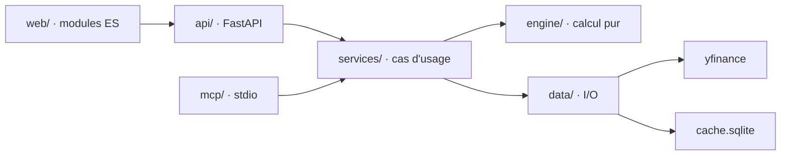

# Architecture

Le « pourquoi » des couches et des choix. La liste canonique des invariants à ne pas
casser vit dans `CLAUDE.md` §Invariants : ce fichier ne la duplique pas.

## Stack

- Python 3.11+ / FastAPI (uvicorn) pour l'API et le service des assets.
- Front **sans build** : HTML + modules ES natifs + Alpine.js ; Plotly, Alpine et Inter
  sont vendorisés dans `src/obole/web/vendor/` — aucune dépendance CDN.
- SQLite (stdlib `sqlite3`, pas d'ORM) pour le cache et toutes les données utilisateur.
- `yfinance` épinglé pour les prix et les comptes ; numpy/pandas pour le calcul ; SDK MCP
  v2 pour la surface IA.

## How it fits together

Les dépendances vont dans **un seul sens** : `web → api → services → engine → data`.
`mcp/` est une seconde surface d'entrée vers `services/`. `engine/` n'importe jamais
`data/` ni `services/` ; `data/` est la seule couche qui touche le réseau et le disque.

## Key decisions

- **`engine/` pur** (zéro I/O, numpy/pandas only) : la méthode est testable sans réseau et
  sans base.
- **Tout passe par le cache** : aucun module hors `data/` n'appelle yfinance ; le cache
  absorbe la fragilité de la source.
- **`config.py` source unique** des constantes et seuils ; aucun nombre magique ailleurs.
- **`observability.py` module feuille** : toutes les couches peuvent l'importer, il
  n'importe rien de l'application.
- **`models.py` contrats typés** : tout champ potentiellement absent de yfinance est
  `Optional` explicite ; l'absence se gère, elle ne crashe pas.
- **Sobriété assumée** : pas d'ORM, pas de build front, dépendances minimales. Une
  fonction pure plutôt qu'une abstraction.
- **Localhost seulement** : un bind non-loopback est refusé sans `OBOLE_ALLOW_REMOTE=1`.
  L'outil n'a pas d'auth, l'exposer serait une faille.
- **MCP : stdout est le canal du protocole** ; la journalisation passe par `observability`
  (stderr). Jamais de `print()` dans cette couche.

## Gotchas

- yfinance est limité : ~20-30 ans de cours mais ~4-5 ans de comptes ; `yf.Search`
  plafonne à ~5 résultats. On gère ces manques par des `warnings`, jamais par un crash.
- Deux séries de prix, deux usages : `raw` pour la valorisation, `adjusted` pour la
  performance. Les confondre fausse toute la fiche.
- La régression est recalculée à trois endroits (serveur + deux calculs client) : toute
  modification de formule doit toucher les trois (détail dans `CLAUDE.md` §Invariants).
- Les moyennes mobiles sont précalculées serveur sur la série pleine, puis décimées.
- Le screener écrit en base depuis plusieurs threads : SQLite en WAL avec `busy_timeout`.
- `spikes/` contient des scripts de calibration jetables, exclus du lint et du format.
- Les assets statiques sont servis avec un hash de contenu (`/static/x.js?v=<hash>`),
  donc un simple rechargement de page suffit côté front.
