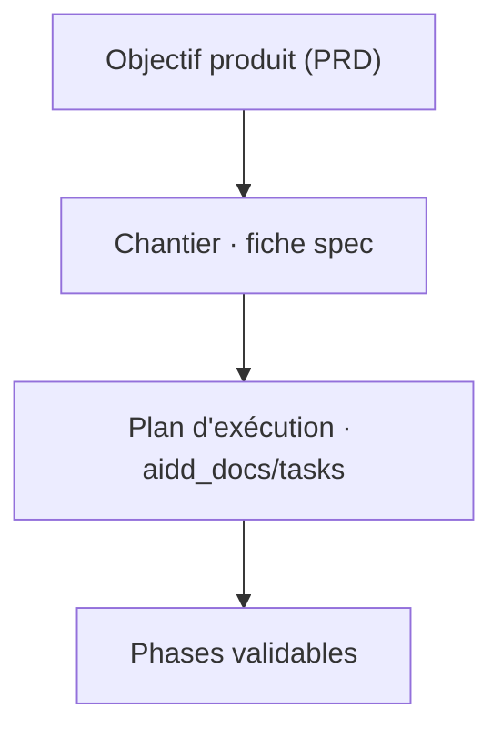

# Backlog

Le backlog n'est pas migré vers les artefacts AIDD : le formalisme maison est plus
riche et fait autorité.

## Supports

| Support | Autorité pour | Rôle |
| --- | --- | --- |
| `CHANTIERS.md` | index, priorité, statut, ordre | la vue d'ensemble du backlog |
| `chantiers/NN-….md` | contexte, objectif, exigences, critères, invariants, jalons | la **spec** d'un chantier |
| `PRD.md` | méthode, seuils calibrés, vision produit | la référence produit |
| `aidd_docs/tasks/` | plan, phases, revue | l'**exécution** d'un chantier |

## Structure

## Representation

| Artefact | Support | Forme native |
| --- | --- | --- |
| Chantier | `chantiers/*.md` | fichier markdown, un par chantier, depuis `_gabarit.md` |
| Statut | `CHANTIERS.md` | `à faire` → `en cours` → `fait` (ou `abandonné`) |
| Priorité | `CHANTIERS.md` | matrice d'Eisenhower Q1–Q4 |
| Impact Pernod | `CHANTIERS.md` + fiche | 🟢 nul / 🟠 indirect / 🔴 direct |
| Plan | `aidd_docs/tasks/<date>_<slug>/plan.md` | frontmatter `status` |

## Workflow

| Support | Statut natif | Sens |
| --- | --- | --- |
| Chantier | `à faire` | fiche prête, pas commencé |
| Chantier | `en cours` | branche dédiée ouverte |
| Chantier | `fait` | fusionné sur `main` |
| Plan AIDD | `pending` → `in-progress` → `implemented` → `reviewed` | avancement de l'exécution |

## Planning

- Priorité : Eisenhower, deux axes orthogonaux — *quand le faire* et *quel rayon d'action
  sur le cœur*.
- Taille : exprimée en sessions ou en jalons, pas en points.
- Itération : une branche par chantier ; ne jamais mélanger deux chantiers.
- Jalon : une étape validable isolément, qui laisse le dépôt vert.

## Relations

- **Fiche → plan** : `plan.md` porte `Source: chantiers/NN-….md` ; la fiche §8 reçoit le
  chemin du plan et le nom de la branche.
- **Fiche → index** : le statut produit reste dans `CHANTIERS.md` ; « fait » seulement
  après fusion.
- **Fin de session** : mettre à jour le statut de l'index et la note de reprise de la
  fiche.
