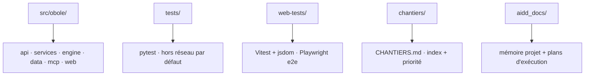

# Codebase Map

## Areas

- `src/obole/api/` : routes FastAPI (`app.py`), uploads bornés (`uploads.py`), service des
  assets avec hash de contenu (`static_files.py`).
- `src/obole/services/` : cas d'usage partagés API ↔ MCP (analyse, screener, indices,
  thèse, portefeuille, watchlist, imports, sérialisation).
- `src/obole/engine/` : calcul pur (régression, labels, qualité, valorisation, dividende,
  portefeuille, screener) — aucune I/O.
- `src/obole/data/` : I/O uniquement (`yahoo.py`, `cache.py`, `backup.py`, `health.py`,
  tables utilisateur : indices, thèses, portefeuille, points de contrôle, imports,
  watchlist et références de fenêtre).
- `src/obole/mcp/` : surface IA — un module par famille d'outils dans `tools/`.
- `src/obole/web/` : front sans build (voir §Front).
- `src/obole/config.py` : constantes et seuils (source unique).
- `src/obole/models.py` : contrats typés échangés entre couches.
- `src/obole/observability.py` : journalisation, `safe_label`, compteurs de santé.
- `tests/` : pytest ; le marqueur `network` isole les appels yfinance.
- `web-tests/` : Vitest + jsdom (parité et unitaires) et `e2e/` Playwright.
- `chantiers/` : une fiche spec par chantier ; `CHANTIERS.md` porte l'index et les priorités.
- `aidd_docs/` : mémoire projet (`memory/`) et plans d'exécution (`tasks/`).
- `spikes/` : scripts de calibration jetables, exclus du lint et du format.

## Entry points

- `run.py` : lancement développement (uvicorn, sans reload).
- `src/obole/__main__.py` : commande `obole` (`--port`, `--mcp`, `--read-only` ; un bind
  non-loopback est refusé sans `OBOLE_ALLOW_REMOTE=1`).
- `src/obole/api/app.py` : application FastAPI.
- `src/obole/mcp/server.py` : serveur MCP (transport stdio).

## Front

Modules ES natifs de `src/obole/web/` : `app.js` (composant Alpine qui assemble les
mixins), `nav.js` (coquille : registre des espaces, rail, entrée active, exclusivité des
vues d'espace, retour à l'accueil), `search.js`, `screener.js`, `indices.js`, `charts.js`,
`cursor.js`, `exportcsv.js`,
`events.js`, `settings.js`, `sections.js` (registre des sections et onglets), `summary.js`,
`portfolio.js`, `portfolio-dividends.js`, `dividend.js`, `valorisation.js`, `thesis.js`,
`suivi.js`, `watchlist.js`, `watchlist-dials.js`, `conviction.js`, `conviction-mixin.js`,
`markdown.js`.
Utilitaires : `api.js` (centralise tous les `fetch`), `thresholds.js`
(maths et seuils reçus de `/api/meta`), `theme.js` (charte couleur), `util.js` (slug,
parsing CSV et nombres).
