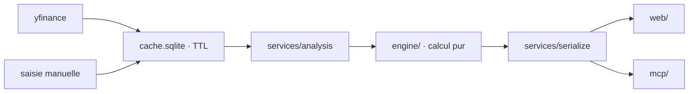

# Data

Les sources, le pipeline et les règles de persistance.

## Sources

- **yfinance** : prix, comptes, identité, recherche. Limites assumées : ~20-30 ans de
  cours, ~4-5 ans de comptes, ~5 résultats de recherche maximum.
- **Saisie manuelle** : comptes importés ou corrigés par l'utilisateur (CSV Excel FR,
  export courtier, collage).
- **Données utilisateur** : portefeuille, thèses, points de contrôle, indices, événements,
  paramètres, brouillons d'import.

## Pipeline

## Models

- Pas de modèle entraîné : la « méthode » est une régression déterministe, pas un ML.
- Deux séries de prix, deux usages : `raw` (Close brut) pour la valorisation, `adjusted`
  (Adj Close, dividendes réinvestis) pour la performance passée. `analysis.py` fait donc
  deux régressions (`reg_raw`, `reg_adj`).

## Reproducibility

- La calibration est figée par un test réseau (`RI.PA`, `z = −3.81`, tolérance 0.15).
- La fixture de parité Python ↔ JS est régénérée par
  `tests/fixtures/generate_regression_parity.py`.

## Cache

- Un seul fichier SQLite (`cache.sqlite`), pas d'ORM ; blobs picklés par `(ticker, kind)`
  avec un timestamp.
- TTL : prix 1 jour, comptes et identité 7 jours, absence de comptes 6 heures (cache
  négatif), recherche 1 jour.
- Écritures : retry borné sur `database is locked` (`config.SQLITE_WRITE_RETRIES`,
  back-off linéaire) — un verrou temporaire ne fait pas échouer une analyse ; un verrou
  permanent remonte après un nombre borné de tentatives.
- `OBOLE_CACHE_DB` redirige la base (tests, e2e) ; `OBOLE_DATA_DIR` déplace les données
  utilisateur hors du paquet installé.
- Le schéma est versionné par `config.SCHEMA_VERSION` et des migrations dans
  `data/cache.MIGRATIONS` ; une base ancienne est mise à niveau à l'ouverture.

## Dégradation

- Un bloc yfinance qui échoue renvoie `None` : jamais de crash sur un champ vide.
- Un ticker sans données lève `TickerNotFound` pour l'API.
- Les manques de comptes sont signalés par des `warnings` (badges de fiabilité), pas par
  une erreur.
- Chaque écriture pilotée par l'IA copie la base au préalable (`cache.sqlite.bak`).

## Sauvegarde

- `data/backup.py` exporte et restaure les données utilisateur en JSON (hors cache).
- `cache.sqlite*`, `logs/`, `thesis_assets/` et `exemple/` sont hors dépôt (`.gitignore`).
