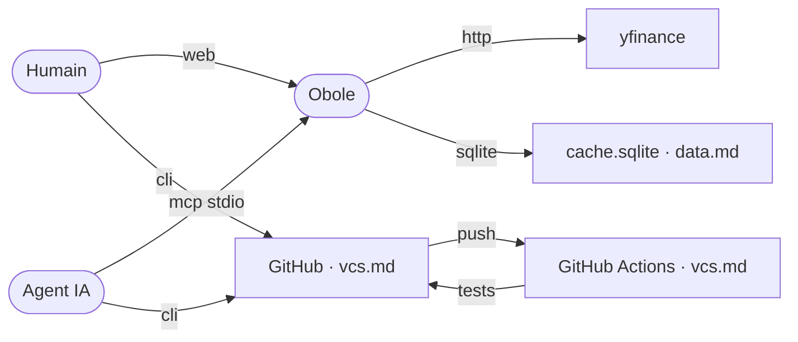

# Ecosystem

## Accès

- **Humain** : navigateur sur `http://127.0.0.1:8000`, terminal pour `./start.sh` et git.
- **Agent IA** : outils MCP en stdio, git pour livrer, fichiers du dépôt.
- **Obole** : yfinance en HTTP, SQLite en local ; aucun appel de modèle.
- **CI** : GitHub Actions exécute lint, types, tests, audit et e2e à chaque push.

## Lancement du serveur MCP

Un client MCP (OpenFox, Claude Desktop…) démarre le serveur lui-même, en **stdio** : il lui
faut la commande exacte, pas une intention. La configuration cliente et ses variantes
(lecture seule, installation `pip`) vit dans le `README.md` §« Le MCP » — un seul domicile.

## Hand-offs

- L'agent **lit** les analyses via MCP et **écrit** dans le portefeuille ou les thèses ;
  Obole persiste, l'humain garde la main sur l'application des imports.
- Le code livré passe par git → CI → merge ; la CI est le garde-fou, pas un verrou serveur.
