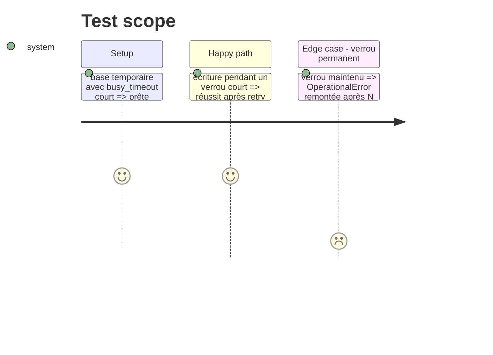

# Instruction: Retry de connexion + constantes

## Architecture projection

> Tree of the final files. ✅ create · ✏️ modify · ❌ delete

```txt
src/obole/
├── config.py        ✏️  constantes SQLITE_WRITE_RETRIES / SQLITE_WRITE_BACKOFF_S
└── data/
    └── cache.py     ✏️  connexion qui retente `execute` + helper de back-off
```

## Test Scope



## Tasks to do

### `1)` Constantes de retry

> Les bornes vivent dans `config.py`, à côté de `SQLITE_BUSY_TIMEOUT`.

1. Ajouter `SQLITE_WRITE_RETRIES = 5` et `SQLITE_WRITE_BACKOFF_S = 0.05`, avec le pourquoi en commentaire.

### `2)` Connexion qui retente

> Une instruction bloquée est rejouée ; une autre erreur remonte immédiatement.

1. Ajouter `_backoff(attempt)` : attend `SQLITE_WRITE_BACKOFF_S × attempt` (isolé pour être neutralisé en test).
2. Ajouter `_retry_locked(operation)` : retente un `OperationalError` contenant « locked », back-off linéaire, lève la dernière erreur.
3. Ajouter la sous-classe `_LockRetryingConnection` qui surcharge `execute` via `_retry_locked`.
4. Créer les connexions avec `factory=_LockRetryingConnection` dans `_conn()`.

## Test acceptance criteria

| Task | Acceptance criteria |
| --- | --- |
| 1 | `pytest -m "not network"` reste vert ; les deux constantes existent et sont lues par `cache.py` |
| 2 | Une écriture sous verrou court finit par réussir ; un verrou permanent remonte `OperationalError` |
