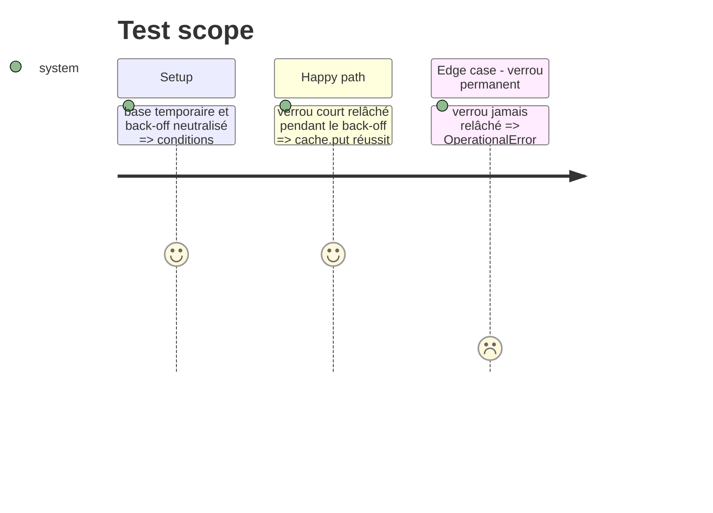

# Instruction: Tests verrou temporaire / permanent

## Architecture projection

> Tree of the final files. ✅ create · ✏️ modify · ❌ delete

```txt
tests/
└── test_cache_retry.py  ✅  verrou temporaire (retry) et permanent (erreur claire)
```

## Test Scope



## Tasks to do

### `1)` Verrou temporaire

> Le retry doit exister pour de vrai, pas seulement sur le papier.

1. Base temporaire (`tmp_path`), `SQLITE_BUSY_TIMEOUT` court, `_backoff` monkeypatché.
2. Une autre connexion tient `BEGIN IMMEDIATE` ; le premier back-off la relâche.
3. `cache.put(...)` réussit, puis `cache.get(...)` relit la valeur.

### `2)` Verrou permanent

> Un verrou qui ne se libère jamais ne doit pas boucler.

1. Le verrou reste tenu ; `_backoff` compte ses appels sans attendre.
2. `cache.put(...)` lève `sqlite3.OperationalError` mentionnant « locked », après exactement `SQLITE_WRITE_RETRIES` tentatives.

## Test acceptance criteria

| Task | Acceptance criteria |
| --- | --- |
| 1 | Le test passe sans attente réelle (back-off neutralisé), en moins d'une seconde |
| 2 | L'erreur remonte, le nombre de tentatives est borné, la suite hors réseau reste verte |
