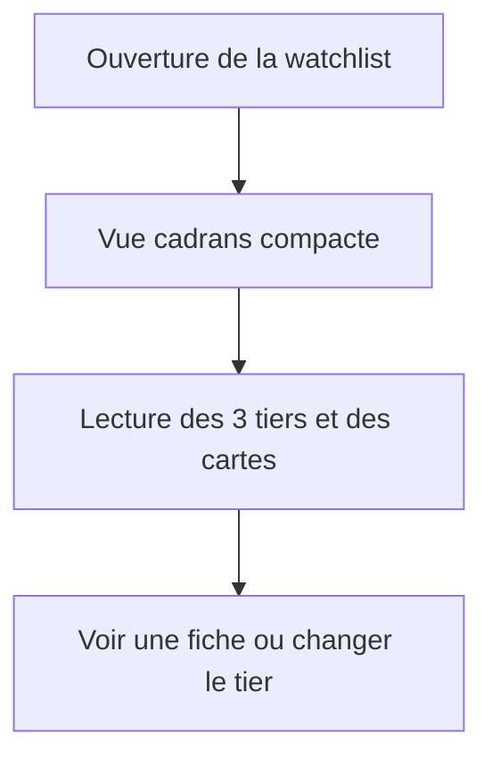
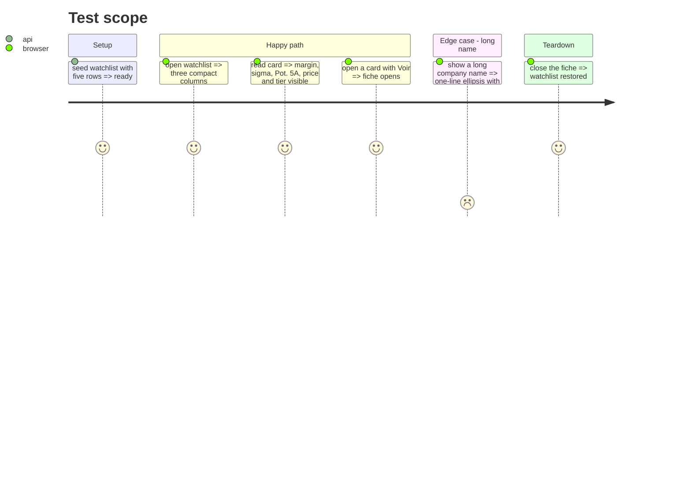

# Instruction: carte et tête de tier compactes

## Architecture projection

```txt
.
├── src/obole/web/index.html     ✏️ tête de tier + carte compacte
└── src/obole/web/style.css      ✏️ compact, a11y, responsive
```

## User Journey



## Test Scope



## Wireframe

```txt
Tier 1 · 3 valeurs                 ◠ 16,67 %
                                   marge moyenne
┌────────────────────────────────────────────────┐
│ ◠  VIE.PA                      −11,08 %      ✕ │
│    Veolia Environnement SA       marge         │
│ Position σ 0,06 σ   │ Pot. 5A 9,77 % VALO     │
│ Prix juste 28,89 CALC                          │
│ [Tier 1 ▾]                              Voir   │
└────────────────────────────────────────────────┘
```

## Tasks to do

### `1)` Tête de tier compacte

1. Remplacer le nom par un `h4` avec `id`, et la `section` par `aria-labelledby`.
2. Réduire le cadran à 58 px ; sortir la valeur dans un `span.wl-dial-text` 15 px.
3. Mettre le libellé « marge moyenne » à 9,5 px.

### `2)` Carte compacte

1. Passer la tête en grille `44px | 1fr | auto | 24px` : mini-cadran, ticker/nom, marge, ✕.
2. Sortir la marge du SVG (valeur 12 px + « marge » 9 px) ; cadran décoratif `aria-hidden`.
3. Passer les métriques en 2 colonnes, Prix juste sur toute la largeur.
4. Passer le select et Voir à 24 px ; le titre devient un `span` (Voir seule ouverture).
5. Ajouter le `aria-label` du ✕, les `:focus-visible`, le reduced motion, le ≤520 px.

## Test acceptance criteria

| Task | Acceptance criteria |
| ---- | ------------------- |
| 1 | La tête de tier est ≤50 px et affiche la moyenne en texte lisible. |
| 2 | La carte est ≤130 px à 1440 et montre toutes les informations. |
| 2 | Le select affiche le tier réel ; Voir ouvre ; ✕ retire ; le nom long est tronqué. |
