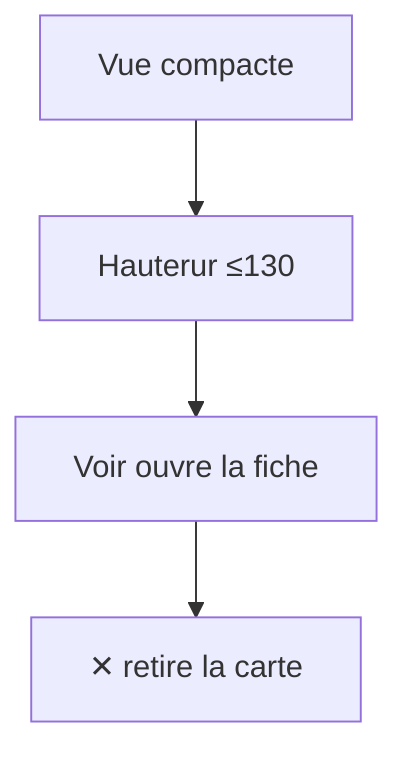
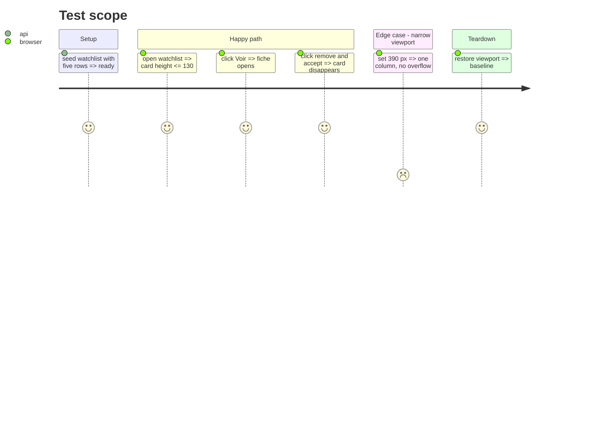

# Instruction: preuves et tests

## Architecture projection

```txt
.
└── web-tests/e2e/watchlist.spec.js   ✏️ hauteur, Voir, ✕, a11y
```

## User Journey



## Test Scope



## Tasks to do

1. Ajouter la hauteur de carte ≤130 px, le Voir, le ✕ avec dialog accepté et les routes DELETE.
2. Vérifier le texte de tête `.wl-dial-text` (tier), le select, le 3/2/1 et le 390 px.
3. Capturer avant/après et lancer les suites front/backend/e2e.

## Test acceptance criteria

| Task | Acceptance criteria |
| ---- | ------------------- |
| 1 | L'e2e mesure une carte ≤130 px et Voir/✕ fonctionnent. |
| 2 | Le tier, le select, les colonnes et le 390 px restent corrects. |
| 3 | Les suites sont vertes et les captures montrent avant/après. |
