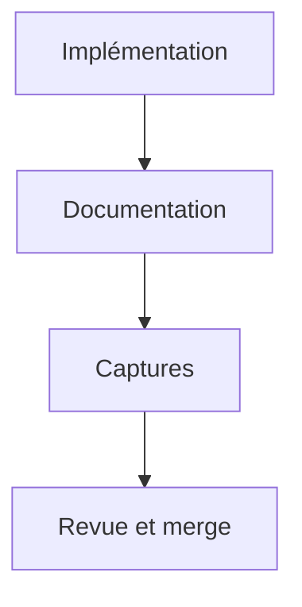
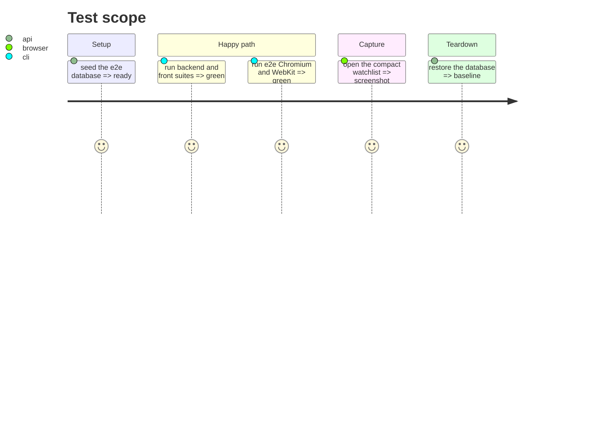

# Instruction: documentation et revue

## Architecture projection

```txt
.
├── chantiers/26.1-watchlist-cadrans-compact.md   ✏️ note
├── CHANTIERS.md                                  ✏️ statut
├── aidd_docs/memory/design.md                    ✏️ carte compacte
├── chantiers/26-watchlist-cadrans-conviction.md  ✏️ note compacte
└── aidd_docs/tasks/.../captures/*.png            ✅ avant/après
```

## User Journey



## Test Scope



## Tasks to do

1. Compléter la note #26.1, l'index, `design.md` et la note #26.
2. Conserver les captures avant/après.
3. Lancer les portes complètes et la revue `/05-review`, puis merger.

## Test acceptance criteria

| Task | Acceptance criteria |
| ---- | ------------------- |
| 1 | La doc décrit la carte compacte et son option A. |
| 2 | Les captures montrent la carte avant/après. |
| 3 | Les suites sont vertes, la revue approuve, le merge est fait. |
