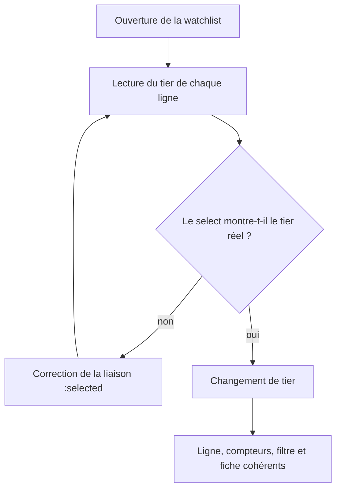
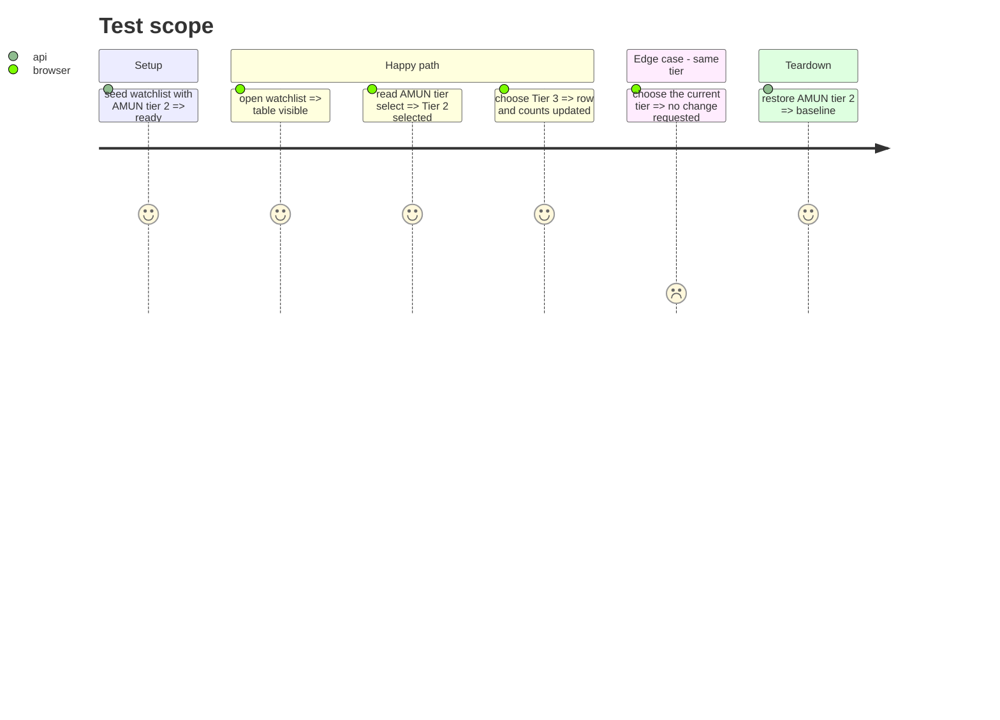

# Instruction: corriger l'affichage du tier dans la watchlist

## Architecture projection

> Tree of the final files. ✅ create · ✏️ modify · ❌ delete

```txt
.
├── src/obole/web/index.html                 ✏️ option :selected, retrait du :value du select
└── web-tests/e2e/watchlist.spec.js          ✏️ ligne Tier 2, sélection affichée, changement
```

## User Journey



## Test Scope



## Wireframe

```txt
┌─────────────────────────────────────────────────────────────┐
│ (1) Watchlist                                           ✕  │
├─────────────────────────────────────────────────────────────┤
│ (2) Entreprise       Tier          Cours     Prix juste     │
│     Valeur A         [Tier 2 ▾]    …         …              │
│     Valeur B         [Tier 1 ▾]    …         …              │
└─────────────────────────────────────────────────────────────┘
```

1. En-tête de la modale watchlist.
2. Ligne du tableau : le select doit afficher le tier réel de la ligne (Tier 2 pour AMUN).

## Tasks to do

### `1)` Corriger la liaison du select

> Le select doit sélectionner l'option correspondant à `r.tier`, pas la première option.

1. Retirer `:value="r.tier"` du `<select class="wl-tier-select">`.
2. Ajouter `:selected="Number(t.id) === Number(r.tier)"` sur chaque `<option>` rendue par `x-for`.
3. Conserver `@change="moveWatchRow(r, $event.target.value)"` et le `:title` basé sur `r.tier`.
4. Vérifier que le changement met à jour la ligne, `watchItems`, les compteurs et le filtre.

### `2)` Ajouter la non-régression e2e

> Une ligne Tier 2 doit afficher Tier 2 et un changement doit rester cohérent.

1. Dans le stub `RUN`, garder une ligne Tier 2 (AMUN/AI) et une ligne Tier 1.
2. Ouvrir la watchlist en vue Tableau et lire la valeur du select de la ligne Tier 2.
3. Intercepter `PUT /api/watchlist/items/<ticker>` et changer la ligne en Tier 3.
4. Vérifier le select, les compteurs et le filtre.

### `3)` Vérifier sur le serveur réel

> Le cas signalé est AMUN en Tier 2.

1. Ouvrir la watchlist réelle, vérifier AMUN = Tier 2 et le filtre Tier 2.
2. Ouvrir la fiche AMUN, vérifier l'étoile/tier.
3. Remettre le tier d'origine si le test l'a modifié.

## Test acceptance criteria

| Task | Acceptance criteria |
| ---- | ------------------- |
| 1 | Une ligne Tier 2 affiche « Tier 2 » dans son select dès l'ouverture ; une ligne Tier 1 affiche « Tier 1 ». |
| 1 | Changer le select met à jour la ligne, les compteurs et le filtre sans rechargement manuel. |
| 2 | L'e2e échoue sur le code d'avant (select à Tier 1) et passe après ; le PUT porte le tier choisi. |
| 3 | Sur le serveur réel, AMUN (Tier 2) et son filtre sont cohérents ; la fiche affiche le même tier. |
