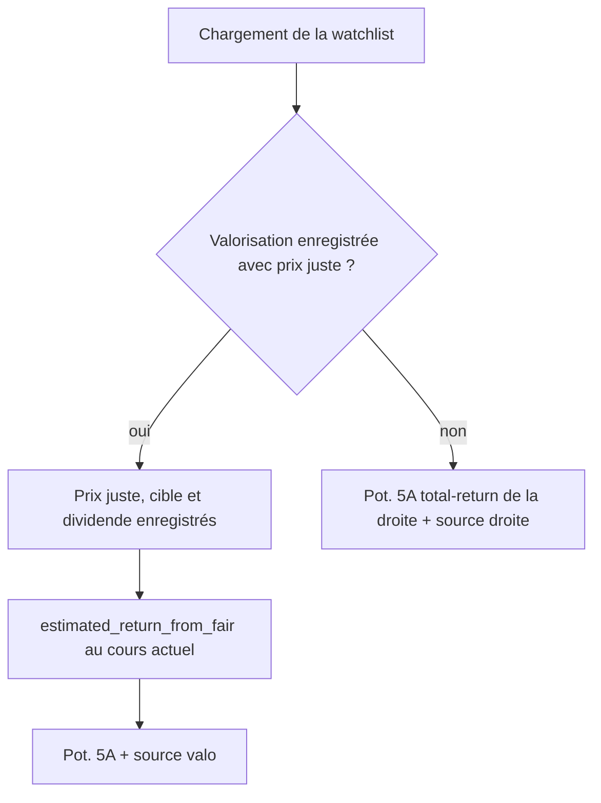
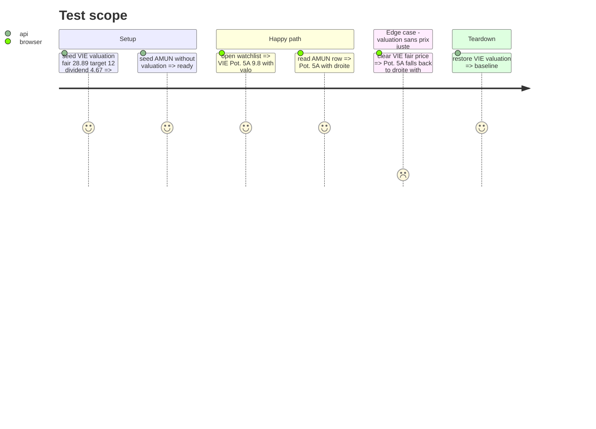

# Instruction: sourcer le Pot. 5A sur la valorisation enregistrée

## Architecture projection

> Tree of the final files. ✅ create · ✏️ modify · ❌ delete

```txt
.
├── src/obole/engine/valuation_calc.py       ✏️ estimated_return_from_fair
├── src/obole/services/watchlist.py          ✏️ Pot. 5A + source
├── src/obole/models.py                      ✏️ pot_5y_source, pot_10y_source
├── src/obole/services/serialize.py          ✏️ champs summary
├── src/obole/mcp/tools/watchlist.py         ✏️ doc de rank_watchlist
├── src/obole/web/index.html                 ✏️ hint/source du Pot. 5A
├── src/obole/web/watchlist.js               ✏️ watchRowTitle
├── tests/test_valuation_calc.py             ✏️ cohérence de la dérivation
├── tests/test_watchlist.py                  ✏️ sources valo/droite
├── tests/test_watchlist_api.py              ✏️ champ exposé
├── tests/test_mcp_tools.py                  ✏️ champ dans le classement
├── web-tests/watchlist.test.js              ✏️ titre de ligne
└── web-tests/e2e/watchlist.spec.js          ✏️ badges valo/droite
```

## User Journey



## Test Scope



## Wireframe

```txt
┌──────────────────┬──────────────────┬──────────────────┐
│ (1) Prix juste   │ (2) Pot. 5A      │ (3) Position σ   │
│ 28,89  CALC      │ 9,8 %   valo     │ …                │
│ objectif 12 %/an │                  │                  │
└──────────────────┴──────────────────┴──────────────────┘
```

1. Prix juste enregistré et sa cible : la source de la marge.
2. Pot. 5A : la valeur et sa source (`valo` si la valorisation enregistrée porte un prix juste, sinon `droite`).
3. Les lectures de risque restent la droite total-return (#25.2).

## Tasks to do

### `1)` Ajouter la dérivation dans le moteur

> Le prix juste, la cible et le dividende enregistrés suffisent à retrouver le rendement de la valorisation au cours actuel.

1. Ajouter `estimated_return_from_fair(fair_price, price, target_pct, horizon, dividend_yield_pct=0)` dans `engine/valuation_calc.py`.
2. Dériver `projeté = fair_price × (1 + (target − dividende)/100)^H`, puis `(projeté / cours)^(1/H) − 1 + dividende`.
3. Refuser les entrées non calculables (prix juste ≤ 0, cours ≤ 0, horizon ≤ 0, cible nette ≤ −100 %).
4. Tester la cohérence : pour `fair = target_entry_price(...)`, le helper redonne `estimated_return(...)`.

### `2)` Exposer le champ

> L'API, le MCP et le front lisent la même source.

1. Ajouter `pot_5y_source` et `pot_10y_source` au modèle `WatchlistRow`.
2. Ajouter `pot_5y_pct`, `pot_10y_pct`, `pot_5y_source`, `pot_10y_source` aux champs du summary MCP (le classement compact doit voir le Pot. 5A et sa source).
3. Mettre à jour le docstring de `rank_watchlist` : Pot. 5A = valorisation enregistrée si prix juste, sinon droite total-return.

### `3)` Sourcer la ligne de watchlist

> La ligne dit d'où vient son Pot. 5A.

1. Dans `_row_from_analysis`, si `saved_fair` existe et que cible/dividende sont disponibles, calculer le Pot. 5A avec le helper et poser `pot_5y_source="valuation"`.
2. Sinon garder le potentiel total-return de la droite et poser `pot_5y_source="regression"`.
3. Poser `pot_10y_source="regression"` (l'horizon 10 ans reste la droite).
4. Si la valorisation existe sans prix juste : source `regression` + warning explicite.

### `4)` Afficher la source

> On ne dit plus « droite » pour une valeur valorisée.

1. Dans la cellule Pot. 5A du tableau, ajouter un hint `valo` / `droite`.
2. Dans `watchRowTitle`, ajouter « Pot. 5A : valorisation enregistrée » ou « Pot. 5A : droite total-return ».
3. Mettre à jour l'en-tête de colonne et la légende : le Pot. 5A suit la valorisation enregistrée si elle existe.

### `5)` Verrouiller

> Tests backend, API, MCP, front, e2e.

1. Tester la ligne VIE (valo) et AMUN (droite) avec des données factices.
2. Tester le champ dans `/api/watchlist/run` et `rank_watchlist`.
3. Tester le titre de ligne front et les badges dans l'e2e.
4. Vérifier que la fiche, la valorisation et le schéma v8 ne changent pas.

## Test acceptance criteria

| Task | Acceptance criteria |
| ---- | ------------------- |
| 1 | La dérivation redonne le rendement estimé de la calculatrice pour un prix juste issu de `target_entry_price`, sur plusieurs prix. |
| 2 | `/api/watchlist/run` et `rank_watchlist` exposent `pot_5y_source` (et le Pot. 5A dans le summary) ; le schéma reste v8. |
| 3 | VIE (prix juste 28,89 ; cible 12 ; dividende 4,67) affiche un Pot. 5A ≈ 9,8 % et `pot_5y_source="valuation"` ; AMUN affiche `regression`. |
| 4 | La cellule Pot. 5A et l'infobulle disent `valo` pour VIE, `droite` pour AMUN ; la fiche reste en vue brute. |
| 5 | Les tests backend/réseau/front/e2e sont verts ; aucune valeur de droite n'est affichée pour une valorisation enregistrée. |
