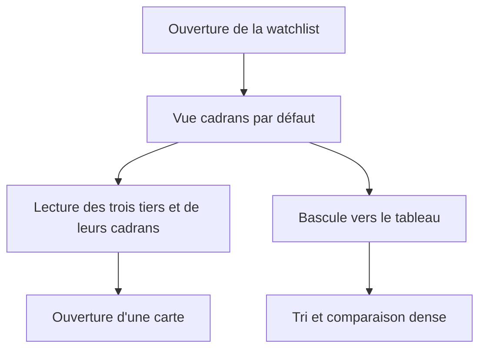
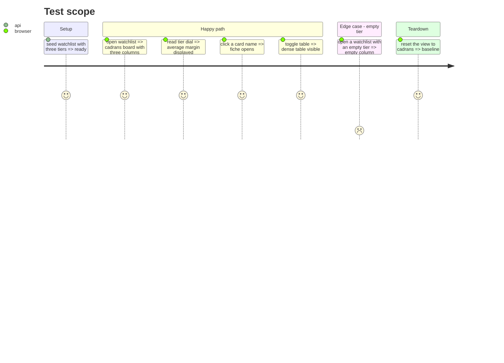

# Instruction: vue cadrans par tier

## Architecture projection

> Tree of the final files. ✅ create · ✏️ modify · ❌ delete

```txt
.
├── src/obole/web/watchlist-dials.js         ✅ géométrie des cadrans, agrégats purs
├── src/obole/web/watchlist.js               ✏️ vue, groupes, marges moyennes, helpers
├── src/obole/web/index.html                 ✏️ tableau de bord cadrans + bascule
├── src/obole/web/style.css                  ✏️ grille des tiers, cartes, cadrans
├── web-tests/watchlist-dials.test.js        ✅ angle, clamp, chemin, agrégats
├── web-tests/watchlist.test.js              ✏️ groupes et marges moyennes
└── web-tests/e2e/watchlist.spec.js          ✏️ cadrans par défaut, tableau, vide
```

## User Journey



## Test Scope



## Wireframe

```txt
┌──────────────────────────────────────────────────────────────────────────────┐
│ (1) Watchlist            [Cadrans] [Tableau]        [Tester mes convictions] │
├──────────────────────────────────────────────────────────────────────────────┤
│ (2) [Tous] [Tier 1] [Tier 2] [Tier 3]   Prix justes enregistrés : n/m        │
│     [ ] masquer sans prix juste enregistré                      Calculé à …   │
├───────────────────────┬───────────────────────┬───────────────────────┐
│ (3) TIER 1            │ (3) TIER 2            │ (3) TIER 3            │
│     ◔ marge moyenne   │     ◔ marge moyenne   │     ◔ —               │
│     n valeurs         │     n valeurs         │     0 valeur          │
│ ┌───────────────────┐ │ ┌───────────────────┐ │ ┌───────────────────┐ │
│ │(4) Valeur         │ │ │(4) Valeur         │ │ │(4) aucune valeur  │ │
│ │ ◔ marge           │ │ │ ◔ marge           │ │ │                   │ │
│ │ z · Pot. 5A/source│ │ │ z · Pot. 5A/source│ │ │                   │ │
│ │ Prix juste/source │ │ │ Prix juste/source │ │ │                   │ │
│ │ [Tier ▾]  [Voir]  │ │ │ [Tier ▾]  [Voir]  │ │ │                   │ │
│ └───────────────────┘ │ └───────────────────┘ │ └───────────────────┘ │
│ ┌───────────────────┐ │                       │                       │
│ │(4) Valeur         │ │                       │                       │
│ └───────────────────┘ │                       │                       │
├───────────────────────┴───────────────────────┴───────────────────────┤
│ (5) Légende : total-return, valorisation enregistrée, fiche brute     │
└──────────────────────────────────────────────────────────────────────────────┘
```

1. En-tête : titre, bascule Cadrans/Tableau, entrée du jeu de convictions.
2. Filtres de tier, couverture des prix justes enregistrés, masquage des lignes sans valorisation.
3. Colonne de tier : cadran de la marge moyenne (ou « — »), nombre de valeurs.
4. Carte : cadran de marge, z, Pot. 5A et sa source, prix juste et sa source, sélecteur de tier, ouverture.
5. Légende : total-return, valorisation enregistrée, fiche brute.

## Tasks to do

### `1)` Créer la géométrie des cadrans

> Un cadran réutilisable, sans dépendance.

1. Créer `watchlist-dials.js` : conversion valeur → angle, clamp, chemin d'arc SVG, texte accessible.
2. Supporter une plage d'affichage (marge −50…+50 %) et une plage 0…100 pour le jeu.
3. Écrire les tests purs (bornes, angle médian, valeur nulle, valeur hors plage).

### `2)` Calculer les groupes et agrégats

> Une seule vérité pour les trois colonnes et le tableau.

1. Ajouter `watchView` (`cadrans` par défaut), `watchTierGroups()` et `watchTierAvgMargin(tier)` au mixin.
2. Utiliser `watchRowsSorted()` / `watchVisibleRows()` pour que filtres, tri et masquage s'appliquent aux cartes.
3. Exposer les helpers de cadran au template.
4. Tester les groupes, les moyennes (ignorent les null), la tier vide.

### `3)` Construire la vue

> Trois colonnes, cartes, bascule.

1. Ajouter la bascule Cadrans/Tableau et le tableau de bord dans `index.html`.
2. Dessiner le cadran de tier et le cadran de carte en SVG, avec la valeur en texte.
3. Garder les actions : ouvrir la fiche, changer le tier, retirer, fermer.
4. Ajouter la légende et les états vides/erreur.
5. Adapter le CSS : 3 colonnes, 1 colonne en dessous de 900 px, focus visible, `prefers-reduced-motion`.

### `4)` Vérifier visuellement et en e2e

> La vue est jugée sur écran.

1. E2e : cadrans par défaut, 3 colonnes, valeur du cadran, bascule tableau, tier vide.
2. Vérifier un viewport étroit (1 colonne) et un viewport large (3 colonnes).
3. Capturer la vue cadrans et le tableau pour la preuve.

## Test acceptance criteria

| Task | Acceptance criteria |
| ---- | ------------------- |
| 1 | Les tests purs couvrent les bornes, le clamp et l'angle ; aucun seuil de label n'est codé en dur. |
| 2 | Les trois colonnes montrent le bon nombre de valeurs ; la marge moyenne ignore les valeurs nulles ; le filtre de tier s'applique. |
| 3 | Chaque carte affiche marge, z, Pot. 5A et sa source, prix juste et sa source ; ouvrir, changer le tier et retirer fonctionnent ; la bascule Tableau montre le tableau dense. |
| 4 | En 1280 px la grille a 3 colonnes, en 390 px 1 colonne ; la capture montre les cadrans et les cartes lisibles. |
