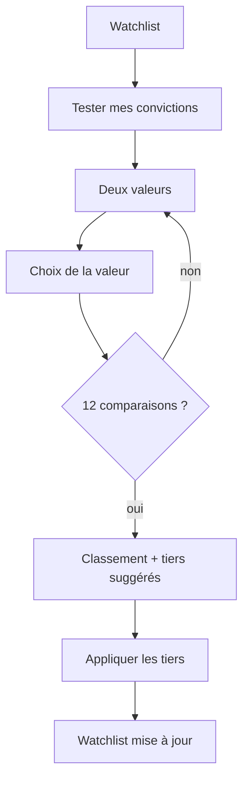
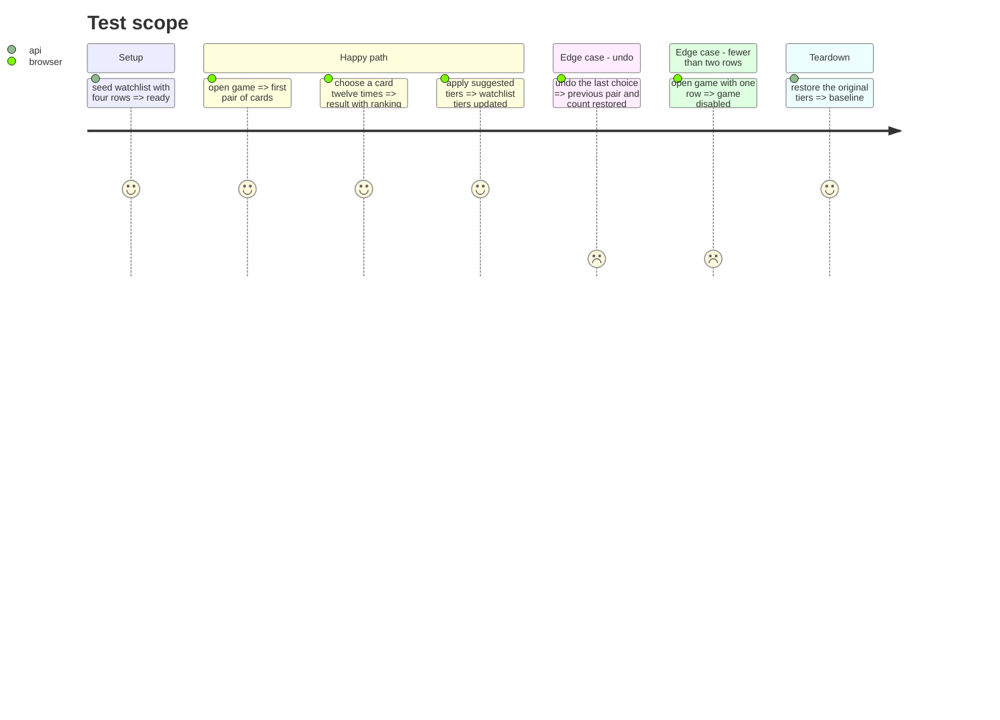

# Instruction: jeu de convictions en duels

## Architecture projection

> Tree of the final files. ✅ create · ✏️ modify · ❌ delete

```txt
.
├── src/obole/web/conviction.js             ✅ Elo, paires, score, tiers suggérés
├── src/obole/web/conviction-mixin.js       ✅ état du jeu, choix, résultat, application
├── src/obole/web/app.js                    ✏️ spread du mixin
├── src/obole/web/index.html                ✏️ écran duel + écran résultat
├── src/obole/web/style.css                 ✏️ duel, cartes, progression, résultat
├── web-tests/conviction.test.js            ✅ Elo, paires, effectifs, application
└── web-tests/e2e/watchlist.spec.js         ✏️ duel, résultat, application
```

## User Journey



## Test Scope



## Wireframe

```txt
┌──────────────────────────────────────────────────────────────────────────────┐
│ (1) ← Watchlist   Tester mes convictions        Comparaison 7 / minimum 12   │
│     [progression]                                                            │
├──────────────────────────────────────────────────────────────────────────────┤
│ (2) Choisis celle en laquelle tu as le plus de conviction                    │
│                                                                              │
│ ┌─────────────────────────────┐  (3) VS  ┌─────────────────────────────┐     │
│ │ (4) Valeur A                │          │ (4) Valeur B                │     │
│ │ Tier · source · marge       │          │ Tier · source · marge       │     │
│ │ ◔ marge · z · Pot. 5A       │          │ ◔ marge · z · Pot. 5A       │     │
│ │ [ Je choisis ]              │          │ [ Je choisis ]              │     │
│ └─────────────────────────────┘          └─────────────────────────────┘     │
│ (5) [Annuler la dernière]                        [Voir le résultat dès 12]   │
└──────────────────────────────────────────────────────────────────────────────┘

┌──────────────────────────────────────────────────────────────────────────────┐
│ (6) ← Watchlist   Ton classement de conviction         12 comparaisons        │
├──────────────────────────────────────────────────────────────────────────────┤
│ (7) [Appliquer les tiers]  [Rejouer]  [Fermer]                               │
│ (8) Rang  Entreprise   Tier actuel → suggéré   Conviction   Δ                │
│      1    Valeur A     Tier 1 → Tier 1         ◔ score       =               │
│      2    Valeur B     Tier 1 → Tier 2         ◔ score       ↓               │
│ (9) Note : effectifs par tier conservés ; basé sur N comparaisons            │
└──────────────────────────────────────────────────────────────────────────────┘
```

1. En-tête du jeu : retour, titre, progression.
2. Consigne : choisir une des deux valeurs.
3. Repère « VS » entre les deux cartes.
4. Carte de choix : valeur, tier, source, marge, z, Pot. 5A ; c'est le bouton de choix.
5. Actions : annuler la dernière comparaison, afficher le résultat après le minimum.
6. En-tête du résultat.
7. Actions : appliquer, rejouer, fermer.
8. Classement : rang, tier actuel → suggéré, score de conviction, variation.
9. Note sur la méthode et le nombre de comparaisons.

## Tasks to do

### `1)` Écrire le moteur de conviction

> Un module pur, testable sans DOM.

1. Créer `conviction.js` : ratings initiaux depuis le tier (Tier 1 > 2 > 3), mise à jour Elo, choix de la paire, score percentile 0-100.
2. Choisir la paire parmi les valeurs les moins comparées, puis les ratings les plus proches ; jamais la même paire deux fois de suite ; RNG injectable.
3. Proposer les tiers en conservant les effectifs actuels (top n1 → Tier 1, n2 suivants → Tier 2, reste → Tier 3) ; tie-break par tier actuel puis ticker.
4. Tester : prior, mise à jour, pas de répétition immédiate, minimum 12, effectifs, score.

### `2)` Brancher l'état du jeu

> Un mixin séparé, sans backend.

1. Créer `conviction-mixin.js` : `openConviction`, `chooseConviction`, `undoConviction`, `finishConviction`, `applyConvictionTiers`, `replayConviction`, `closeConviction`.
2. `openConviction` refuse moins de deux lignes valides et ferme la modale watchlist ; le retour rouvre la watchlist.
3. Conserver l'historique des choix pour l'annulation et le rejeu.
4. Ajouter le mixin dans `app.js`.

### `3)` Construire les écrans

> Un duel lisible, un résultat actionnable.

1. Ajouter l'écran duel et l'écran résultat dans `index.html`.
2. Afficher les métriques utiles sur chaque carte : tier, marge, z, Pot. 5A et source.
3. Ajouter la progression, le minimum de 12, l'état sélectionné, l'annulation et le résultat.
4. Ajouter le CSS (cartes, VS, cadran de conviction, résultat, responsive, focus).
5. Gérer le clavier ←/→ et l'échappement.

### `4)` Appliquer les tiers

> Le jeu propose, l'utilisateur applique.

1. Calculer les changements `tier actuel → suggéré`.
2. Appliquer séquentiellement via `api.setWatchTier` ; mettre à jour `watchRows`/`watchItems` ; rapporter une erreur sans masquer les changements déjà appliqués.
3. Mettre à jour les compteurs et la vue cadrans ; le retour à la watchlist recharge l'ensemble.
4. Tester l'application, le rejeu et l'annulation en Vitest/e2e.

## Test acceptance criteria

| Task | Acceptance criteria |
| ---- | ------------------- |
| 1 | Le moteur choisit toujours deux valeurs distinctes, jamais la même paire deux fois de suite, et produit un classement stable pour une séquence donnée. |
| 1 | Les tiers suggérés conservent les effectifs actuels (n1/n2/n3) ; le score est dans 0…100. |
| 2 | Moins de deux valeurs désactive le jeu ; le retour rouvre la watchlist ; l'état est réinitialisé à la fermeture. |
| 3 | Le duel affiche les deux cartes et leurs métriques ; la progression atteint 12 ; l'annulation restaure la paire et le compte. |
| 4 | Le résultat affiche rang, tiers actuel/suggéré et changements ; appliquer met à jour la watchlist ; rejouer repart du prior. |
| 4 | Aucun schéma, aucune route d'écriture nouvelle, aucun outil MCP ; l'application passe par la route tier existante. |
