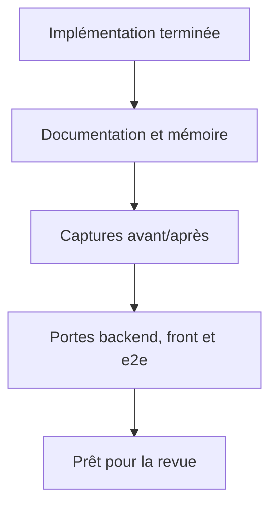
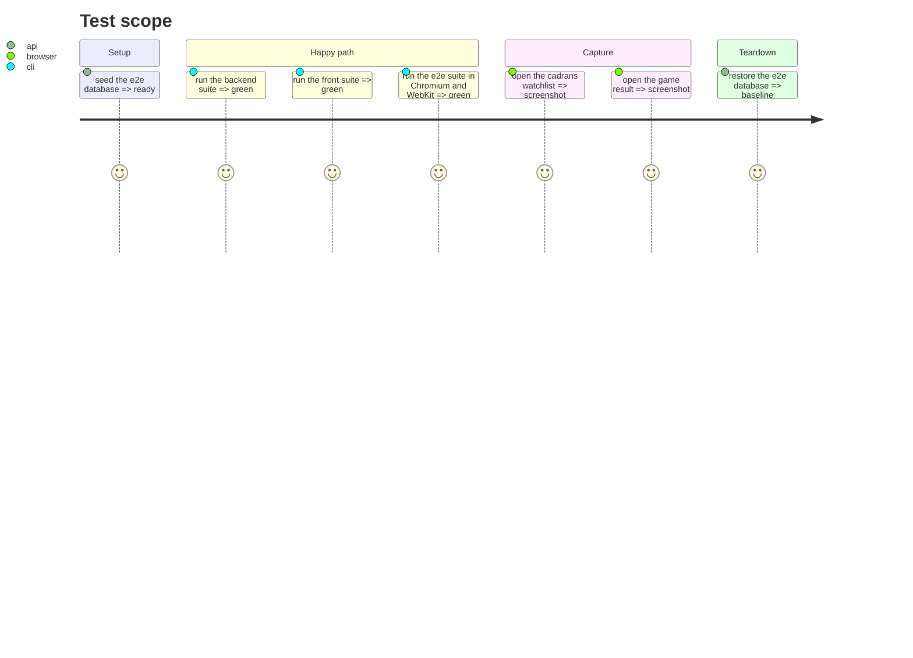

# Instruction: documentation et preuves finales

## Architecture projection

> Tree of the final files. ✅ create · ✏️ modify · ❌ delete

```txt
.
├── chantiers/26-watchlist-cadrans-conviction.md          ✏️ note de reprise
├── CHANTIERS.md                                         ✏️ statut de l'index
├── CLAUDE.md                                            ✏️ invariants cadrans/jeu/Pot. 5A
├── aidd_docs/memory/api.md                              ✏️ pot_5y_source, summary
├── aidd_docs/memory/design.md                           ✏️ cadrans, duel, view toggle
├── aidd_docs/memory/codebase-map.md                     ✏️ watchlist-dials, conviction
└── aidd_docs/tasks/2026_10/2026_10_25_watchlist-cadrans-conviction/captures/*.png  ✅
```

## User Journey



## Test Scope



## Tasks to do

### `1)` Mettre à jour la documentation

1. Remplir la note de reprise de #26 (décisions, pièges, valeurs mesurées).
2. Mettre l'index `CHANTIERS.md` au statut réel.
3. Compléter l'invariant watchlist de `CLAUDE.md` : Pot. 5A valorisation enregistrée si prix juste, sinon droite ; cadrans et jeu sans schéma ; jeu sans écriture MCP.
4. Mettre à jour `api.md` (`pot_5y_source`, summary), `design.md` (cadrans/duel/bascule) et `codebase-map.md` (nouveaux modules).

### `2)` Capturer les preuves

1. Capturer la vue cadrans par défaut (3 colonnes, cadrans, cartes).
2. Capturer le tableau avec les badges `valo`/`droite`.
3. Capturer le duel et l'écran de résultat.
4. Conserver les captures dans `captures/` avec des noms explicites.

### `3)` Passer les portes

1. Backend : `pytest -m "not network"`, `pytest -m network`, `ruff check`, `mypy`.
2. Front : `npm test`.
3. E2e Chromium + WebKit.
4. Vérifier le serveur réel (AMUN tier 2, VIE valo, jeu sur les valeurs réelles).

### `4)` Clore le plan

1. Cocher les critères de chaque phase.
2. Passer `plan.md` en `implemented` et les phases en `done`.
3. Laisser la revue (`/05-review`) décider `reviewed` et le merge.

## Test acceptance criteria

| Task | Acceptance criteria |
| ---- | ------------------- |
| 1 | La fiche, l'index, CLAUDE et la mémoire décrivent le Pot. 5A sourcé, les cadrans et le jeu sans schéma. |
| 2 | Les captures montrent la vue cadrans, le tableau avec les sources, le duel et le résultat. |
| 3 | Les suites backend (dont réseau), front et e2e Chromium/WebKit sont vertes ; la calibration Pernod est inchangée. |
| 4 | Toutes les phases sont `done`, le plan est `implemented`, aucun placeholder ne reste. |
