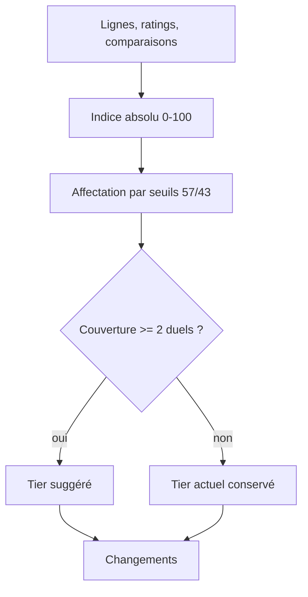
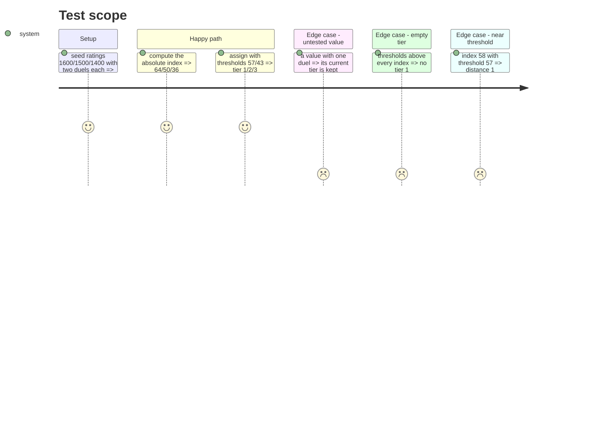

# Instruction: moteur de conviction absolu

## Architecture projection

> Tree of the final files. ✅ create · ✏️ modify · ❌ delete

```txt
.
├── src/obole/web/conviction.js       ✏️ indice absolu, seuils, couverture, distance
└── web-tests/conviction.test.js      ✏️ tests des nouvelles fonctions
```

## User Journey



## Test Scope



## Tasks to do

### `1)` Ajouter l'indice absolu et la distance aux seuils

> Une échelle 0-100 ancrée sur le rating neutre, sans percentile.

1. Exporter `convictionIndex(rating)` : `100 / (1 + 10 ** ((1500 - rating) / 400))`, arrondi à l'entier.
2. Exporter `tierForIndex(index, thresholds)` : Tier 1 si `index >= thresholds.tier1`, Tier 2 si `index >= thresholds.tier2`, sinon Tier 3.
3. Exporter `thresholdDistance(index, thresholds)` : seuil le plus proche et distance absolue.
4. Exporter `MIN_COMPARISONS_PER_ROW = 2`.

### `2)` Affecter les tiers avec la couverture

> Une fonction pure, indépendante du mixin.

1. Exporter `suggestTiersByThresholds(rows, ratings, comparisons, thresholds)` : une map ticker → tier.
2. Si `comparisons[ticker] < MIN_COMPARISONS_PER_ROW`, conserver `Number(row.tier)`.
3. Ne pas conserver les effectifs : aucune lecture des comptes par tier.
4. Laisser `convictionScore` et `suggestTiers` en place : le mixin les utilise encore jusqu'en phase 3.

### `3)` Tester le moteur

> Les cas mesurés pendant le débat deviennent des tests.

1. Tester l'indice : 1500 → 50, 1600 → 64, 1400 → 36, 1550 → 57, 1450 → 43.
2. Tester les priors : 1600/1500/1400 avec deux duels → 1/2/3.
3. Tester la couverture : une valeur à un duel garde son tier, même si l'indice change de tier.
4. Tester un tier vide : seuils 75/65 avec 1600/1500/1400 → aucun Tier 1.
5. Tester `thresholdDistance(58, { tier1: 57, tier2: 43 })` → `{ threshold: 57, distance: 1 }`.

## Test acceptance criteria

| Task | Acceptance criteria |
| ---- | ------------------- |
| 1 | `convictionIndex(1500) = 50`, `convictionIndex(1600) = 64`, `convictionIndex(1400) = 36`. |
| 1 | `thresholdDistance(58, { tier1: 57, tier2: 43 })` renvoie le seuil 57 et la distance 1. |
| 2 | Les ratings 1600/1500/1400 avec deux duels donnent Tier 1/2/3. |
| 2 | Une valeur à un seul duel conserve son tier actuel. |
| 2 | Avec les seuils 75/65, aucune valeur n'est proposée en Tier 1. |
| 3 | Les tests ajoutés passent ; les tests existants du percentile et des effectifs restent verts. |
