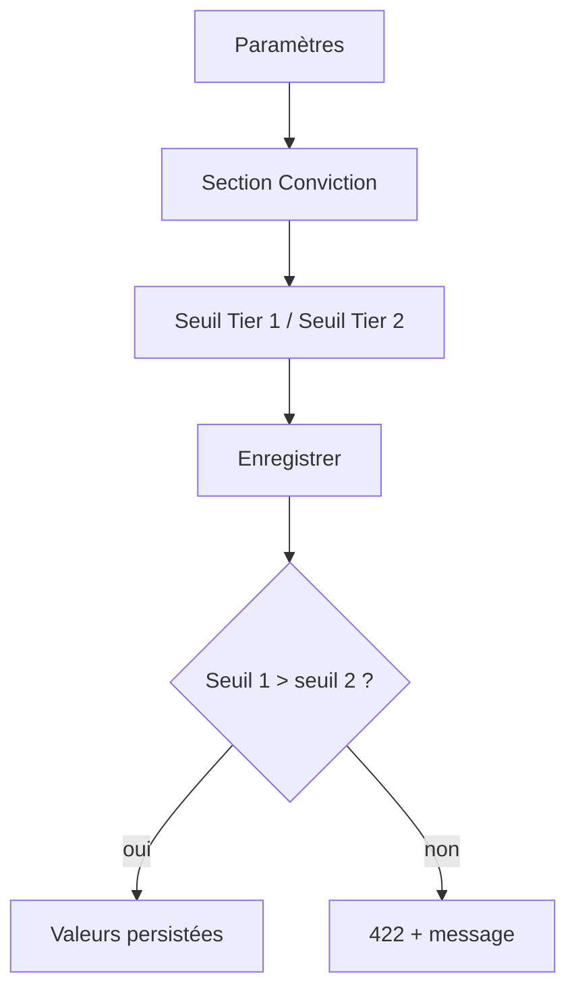
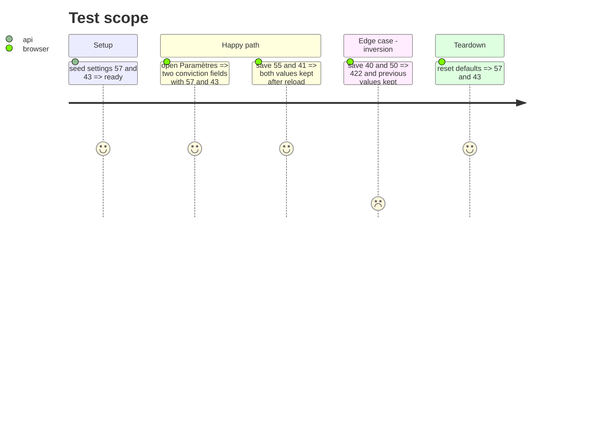

# Instruction: réglages des seuils de conviction

## Architecture projection

> Tree of the final files. ✅ create · ✏️ modify · ❌ delete

```txt
.
├── src/obole/config.py          ✏️ deux SETTING_DEFS + groupe conviction
├── src/obole/data/cache.py      ✏️ validation croisée Tier 1 > Tier 2
├── src/obole/web/index.html     ✏️ section Conviction + actions partagées
├── src/obole/web/style.css      ✏️ actions de réglages
└── tests/test_settings.py       ✏️ défauts, persistance, inversion
```

## User Journey



## Test Scope



## Wireframe

```txt
┌──────────────────────────────────────────────────┐
│ (1) Paramètres                              ✕    │
├──────────────────────────────────────────────────┤
│ (2) Mesure technique                             │
│     MM courte [11]      MM longue [200]          │
│                                                  │
│ (3) Conviction                                   │
│     Seuil Tier 1 [57] / 100                      │
│     Seuil Tier 2 [43] / 100                      │
│     (57/43 = milieux des ancres 1600/1500/1400)  │
│                                                  │
│ (4) [Enregistrer]  [Rétablir les défauts]        │
└──────────────────────────────────────────────────┘
```

1. En-tête de la modale.
2. Réglages techniques existants (moyennes mobiles).
3. Nouvelle section : les deux seuils de l'indice de conviction.
4. Actions communes : une seule paire Enregistrer / Rétablir pour tous les groupes.

## Tasks to do

### `1)` Définir les deux réglages

> Des entiers 0-100, dans la source unique `config.py`.

1. Ajouter `conviction_tier1_min` (défaut 57) et `conviction_tier2_min` (défaut 43) à `SETTING_DEFS`, bornes 0-100, groupe `conviction`.
2. Ajouter `conviction` à `SETTING_GROUPS`, après `technique`.
3. Vérifier que `get_settings` fusionne les défauts et que `_settings_payload` les sérialise.

### `2)` Valider la cohérence

> Un seuil Tier 1 inférieur au Tier 2 n'a pas de sens.

1. Dans `set_settings`, après la cohérence des moyennes mobiles, refuser `tier1 <= tier2` avec un `ValueError`.
2. Le message doit être explicite : « Le seuil Tier 1 doit être supérieur au seuil Tier 2 ».
3. Vérifier que la route `PUT /api/settings` transforme ce `ValueError` en 422.

### `3)` Ajouter la section Paramètres

> Une section de plus, sans dupliquer les actions.

1. Sortir le message d'erreur et les boutons Enregistrer / Rétablir de la section « Mesure technique ».
2. Ajouter la section « Conviction » avec `groupDefs('conviction')`, les deux champs et un aperçu « valeur / 100 ».
3. Placer les actions communes après les deux sections ; ajouter `.settings-actions` dans le CSS.
4. Conserver `resetSettings` (tous les groupes) et `saveSettings` (tous les groupes).

### `4)` Tester les réglages

> API et modale.

1. Tester les défauts 57/43 et le groupe `conviction` dans le payload.
2. Mettre à jour l'assertion du dict exact de `get_settings` avec les deux nouvelles clés.
3. Tester la persistance de 60/40 et la relecture.
4. Tester le 422 sur 40/50 et l'absence de modification.
5. Tester la modale : deux champs, sauvegarde, rétablissement.

## Test acceptance criteria

| Task | Acceptance criteria |
| ---- | ------------------- |
| 1 | `GET /api/settings` renvoie les défauts 57 et 43, et le groupe `conviction`. |
| 2 | `PUT /api/settings` avec 60/40 renvoie 200 et persiste ; 40/50 renvoie 422. |
| 3 | La modale Paramètres affiche les deux seuils et une seule paire d'actions. |
| 3 | Enregistrer 55/41 puis rouvrir la modale affiche 55/41 ; Rétablir affiche 57/43. |
| 4 | Aucune migration, aucun changement de schéma. |
