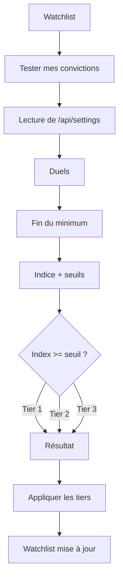
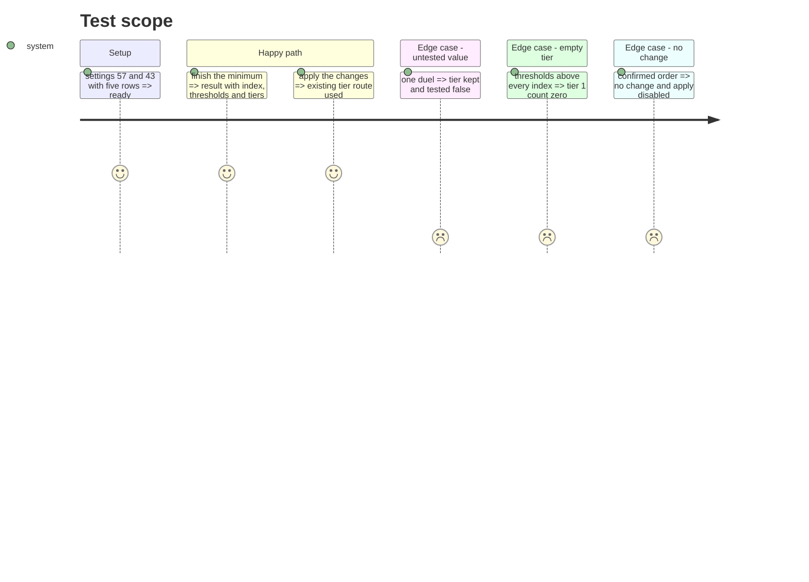

# Instruction: résultat et application par seuils

## Architecture projection

> Tree of the final files. ✅ create · ✏️ modify · ❌ delete

```txt
.
├── src/obole/web/conviction-mixin.js  ✏️ lecture des seuils, résultat enrichi, compteurs
├── src/obole/web/conviction.js        ✏️ retrait du percentile et des effectifs
├── src/obole/web/index.html           ✏️ seuils, badges, duels, compteurs
├── src/obole/web/style.css            ✏️ ligne de seuils, badges, duels
└── web-tests/conviction.test.js       ✏️ résultat, couverture, tier vide, changements
```

## User Journey



## Test Scope



## Wireframe

```txt
┌──────────────────────────────────────────────────────────────────────────────┐
│ (1) ← Watchlist   Ton classement de conviction          12 comparaisons      │
├──────────────────────────────────────────────────────────────────────────────┤
│ (2) Seuils : Tier 1 ≥ 57 · Tier 2 ≥ 43 · indice 0-100 (50 = neutre)         │
│ (3) [Appliquer les tiers]  [Rejouer]  [Fermer]                               │
│ (4) Rang  Entreprise   Tier actuel → suggéré   Conviction   Δ                │
│      1    ACA          Tier 1 → Tier 1         ◔ 70 · 5 duels  =            │
│      2    AMUN         Tier 2 → Tier 1         ◔ 58 · 4 duels  ↑            │
│      3    VIE          Tier 1 → Tier 2         ◔ 56 · 5 duels  ↓ [limite]   │
│ (5) Tier 1 : 2 · Tier 2 : 1 · Tier 3 : 2 · 12 comparaisons                   │
│ (6) Aucun changement : tes convictions confirment tes tiers.                 │
└──────────────────────────────────────────────────────────────────────────────┘
```

1. En-tête du résultat et nombre de comparaisons.
2. Ligne des seuils et de l'échelle (0-100, 50 = neutre).
3. Actions : appliquer, rejouer, fermer.
4. Tableau : rang, valeur, tier actuel → suggéré, indice + duels, variation ; badges « conservé » et « limite ».
5. Compteurs par tier et total des comparaisons.
6. Message affiché seulement quand aucun tier ne change.

## Tasks to do

### `1)` Brancher les seuils dans le mixin

> Lire les réglages à l'ouverture, puis classer.

1. Rendre `openConviction` asynchrone : ouvrir la modale, fermer la watchlist, puis appeler `api.settings()`.
2. Valider `conviction_tier1_min` et `conviction_tier2_min` (entiers, Tier 1 > Tier 2) ; en cas d'échec, afficher `convictionError` dans la modale et ne pas créer de paire.
3. Mémoriser `convictionThresholds` pour la session ; ne pas les relire à chaque duel.
4. Dans `finishConviction`, appeler `suggestTiersByThresholds(rows, ratings, comparisons, thresholds)`.
5. Construire chaque ligne avec `score` (indice), `suggested_tier`, `comparisons`, `tested`, `limit`, `distance`, `threshold` ; trier par indice, puis tier actuel, puis ticker.
6. Ajouter `convictionTierSummary()` (compteurs 1/2/3) et `convictionNoChange()`.

### `2)` Construire le résultat

> Rendre les seuils et la couverture lisibles.

1. Ajouter la ligne des seuils et la note d'échelle au-dessus du tableau.
2. Afficher l'indice dans le cadran et le nombre de duels sous le cadran.
3. Afficher « conservé » si `!tested` et « limite » si `tested && limit`, avec un `title` explicite.
4. Afficher les compteurs par tier dans le pied ; un tier vide reste visible avec zéro.
5. Afficher le message « Aucun changement… » quand `convictionNoChange()` ; l'action Appliquer reste désactivée.
6. Conserver l'application séquentielle par `api.setWatchTier` et la mise à jour de `watchRows` / `watchItems`.

### `3)` Retirer l'ancien moteur

> Une seule règle de tiers.

1. Supprimer `convictionScore` et `suggestTiers` de `conviction.js` quand le mixin ne les importe plus.
2. Mettre à jour les imports et les tests qui les utilisent.
3. Vérifier qu'aucun autre module ne les référence.

### `4)` Tester le résultat

> Les cas du débat deviennent des tests de mixin.

1. Tester un résultat à cinq valeurs : indices, tiers suggérés, compteurs.
2. Tester une valeur à un duel : `tested` faux et tier conservé.
3. Tester un tier vide : compteur à zéro, aucun Tier 1.
4. Tester l'absence de changement : `convictionNoChange()` vrai, changements vides.
5. Tester que l'application appelle la route existante et met à jour `watchRows` (API simulée).

## Test acceptance criteria

| Task | Acceptance criteria |
| ---- | ------------------- |
| 1 | `finishConviction` produit des lignes avec un indice entier, un tier suggéré et les seuils utilisés. |
| 1 | Une valeur à moins de 2 duels garde son tier et porte `tested: false`. |
| 2 | Le résultat affiche les seuils, l'indice, les duels et les compteurs par tier. |
| 2 | Un tier vide est affiché avec zéro, jamais comblé. |
| 2 | Sans changement, le message s'affiche et Appliquer est désactivé. |
| 3 | Plus aucun code de tiers ne lit le percentile ni les effectifs. |
| 4 | Les tests du moteur et du mixin passent ; l'application utilise la route tier existante. |
