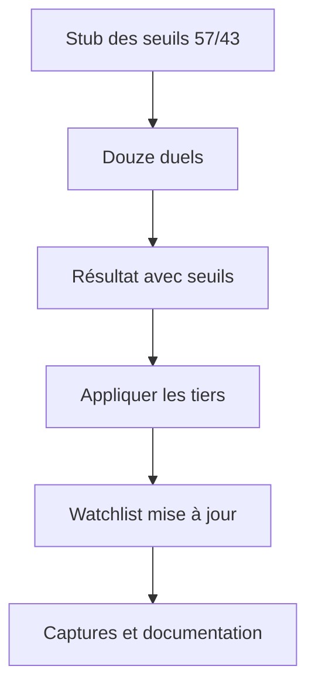
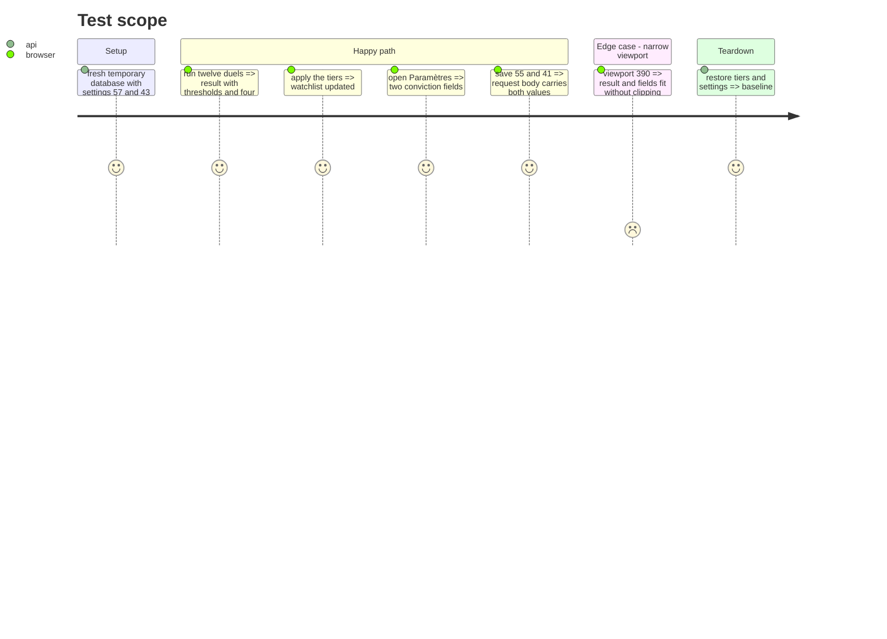

# Instruction: preuves et documentation

## Architecture projection

> Tree of the final files. ✅ create · ✏️ modify · ❌ delete

```txt
.
├── web-tests/e2e/watchlist.spec.js                  ✏️ résultat + Paramètres
├── chantiers/27-conviction-tiers.md                 ✏️ statut et note de reprise
├── chantiers/26-watchlist-cadrans-conviction.md     ✏️ note « étendu par #27 »
├── CHANTIERS.md                                     ✏️ statut de l'index
├── CLAUDE.md                                        ✏️ invariant seuils et couverture
├── aidd_docs/memory/design.md                       ✏️ résultat 0-100 + seuils
├── captures/conviction-seuils.png                   ✅ preuve du résultat
└── captures/conviction-parametres.png               ✅ preuve des réglages
```

## User Journey



## Test Scope



## Tasks to do

### `1)` Mettre à jour le parcours e2e du jeu

> Un parcours déterministe, indépendant des réglages réels.

1. Ajouter un helper `routeSettings(page, values)` qui répond à `GET /api/settings` et capture les `PUT`.
2. Dans le test du jeu, forcer la valeur du Tier 3 (OR.PA) à gagner ses duels pour provoquer un changement T3 → T2.
3. Vérifier la ligne des seuils, les quatre lignes du résultat et le compteur de duels.
4. Vérifier que Appliquer est actif, applique via la route tier, puis affiche « Tiers appliqués ».
5. Ajouter un cas « aucun changement » : les mêmes choix que l'ordre des tiers, message affiché et action désactivée.

### `2)` Tester la section Paramètres

> Les deux seuils, la sauvegarde et le rétablissement.

1. Ouvrir la modale Paramètres depuis l'en-tête.
2. Vérifier les champs des seuils et leurs valeurs 57/43.
3. Saisir 55/41, enregistrer et vérifier le corps du `PUT`.
4. Rouvrir et vérifier que les valeurs affichées sont celles du serveur simulé.
5. Vérifier que le message d'erreur et les actions ne sont affichés qu'une fois.

### `3)` Mettre à jour la documentation

> Le jalon, jamais le commit.

1. Passer la fiche #27 en **fait** et remplir la note de reprise (mesures, décisions, pièges).
2. Passer la ligne #27 de `CHANTIERS.md` en **fait**.
3. Remplacer dans `CLAUDE.md` l'invariant « tiers suggérés à effectifs constants » par les seuils absolus et la couverture ; mentionner les tiers vides.
4. Mettre à jour `aidd_docs/memory/design.md` : indice 0-100, seuils 57/43, badges.
5. Ajouter dans la fiche #26 une note « étendu par #27 » sans réécrire l'historique.

### `4)` Prendre les captures

> Une preuve lisible du résultat et du réglage.

1. Démarrer un serveur frais (`OBOLE_CACHE_DB` jetable ou port e2e), jamais la base réelle.
2. Capturer le résultat avec seuils, badges et compteurs.
3. Capturer la section Paramètres avec les deux champs.
4. Vérifier le rendu à 390 px.

## Test acceptance criteria

| Task | Acceptance criteria |
| ---- | ------------------- |
| 1 | Le parcours du jeu affiche les seuils, quatre lignes et applique un changement T3 → T2. |
| 1 | Le cas sans changement affiche le message et laisse Appliquer désactivé. |
| 2 | La modale affiche les deux seuils, capture 55/41 et les actions une seule fois. |
| 3 | La fiche, l'index et `CLAUDE.md` décrivent les seuils et la couverture ; aucun SHA cité. |
| 4 | Les captures montrent le résultat et les Paramètres, y compris à 390 px. |
| 4 | Les nouveaux parcours passent sur Chromium et WebKit ; les échecs WebKit pré-existants restent hors périmètre. |
