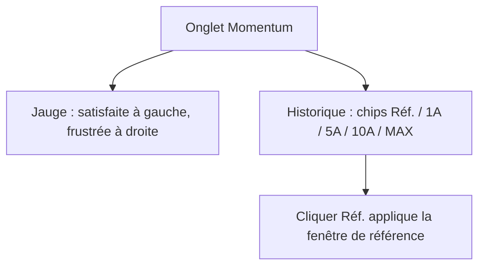
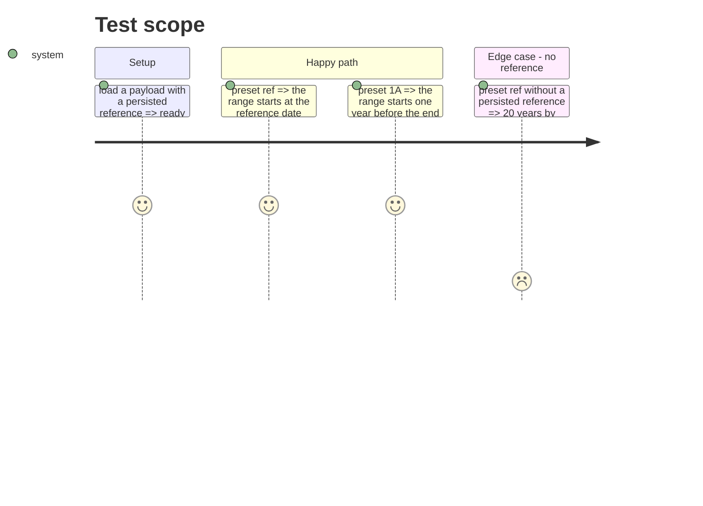

# Instruction: jauge simplifiée et chip Réf.

## Architecture projection

> Tree of the final files. ✅ create · ✏️ modify · ❌ delete

```txt
.
├── src/obole/web/index.html      ✏️ échelle satisfaite/frustrée + chip Réf.
├── src/obole/web/momentum.js     ✏️ référence partagée + preset « ref »
└── web-tests/momentum.test.js    ✏️ test du preset Réf.
```

## User Journey



## Test Scope



## Wireframe

```txt
┌──────────────────────────────────────────────────────────────┐
│ (1) Satisfaction de la foule                          0,54  │
│  satisfaite ●─────────●────────○─────────────● frustrée     │
├──────────────────────────────────────────────────────────────┤
│ (2) Historique du régime                                     │
│  [Réf.] [1A] [5A] [10A] [MAX]        ☐ log  ☐ droite        │
└──────────────────────────────────────────────────────────────┘
```

1. Jauge : deux mots seulement, les côtés ne changent pas.
2. Chips de l'historique : « Réf. » précède 1A et applique la fenêtre de référence.

## Tasks to do

### `1)` Simplifier l'échelle

> Deux mots au lieu de quatre.

1. Remplacer les deux libellés de `.gauge-scale` par `satisfaite` et `frustrée` (sans « gaz » ni « liquide »).
2. Ne pas toucher au titre, à l'aiguille ni aux zones.

### `2)` Partager la fenêtre de référence

> Une seule définition de la référence, pour la table et l'historique.

1. Extraire `_momReferenceStart(end)` de `momRange()` : date persistée (`data.watch.ref.start`) sinon 20 ans (30 pour les financières).
2. Faire appeler `_momReferenceStart` par `momRange()` quand `momWindow` est nul.
3. Dans `momPreset`, accepter `"ref"` : `momEnd = end`, `momStart = _momReferenceStart(end)`.

### `3)` Poser le chip

1. Ajouter un bouton `Réf.` avant `1A` dans la barre de l'historique, `@click="momPreset('ref')"`.
2. Garder 10 ans comme défaut : `drawMomentum` initialise toujours sur `_momStartBefore(end, 10)`.

### `4)` Tester

1. `momPreset("ref")` avec une référence persistée place `momStart` sur la date de référence.
2. Sans référence persistée, `momPreset("ref")` applique 20 ans (30 si `kind === "financial"`).

## Test acceptance criteria

| Task | Acceptance criteria                                                                 |
| ---- | ----------------------------------------------------------------------------------- |
| 1    | L'échelle affiche « satisfaite » et « frustrée », plus « gaz » ni « liquide ».       |
| 2    | `momRange()` et `momPreset("ref")` lisent la même référence.                         |
| 3    | Le chip « Réf. » est le premier de la barre et laisse le défaut à 10 ans.            |
| 4    | Avec une référence persistée, le preset place la plage sur cette date.               |
