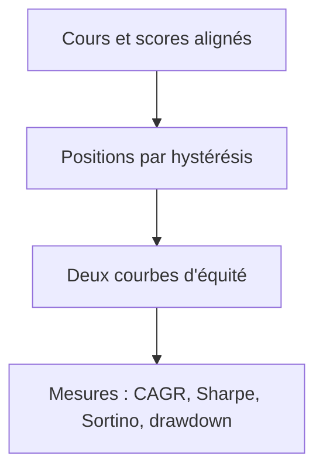
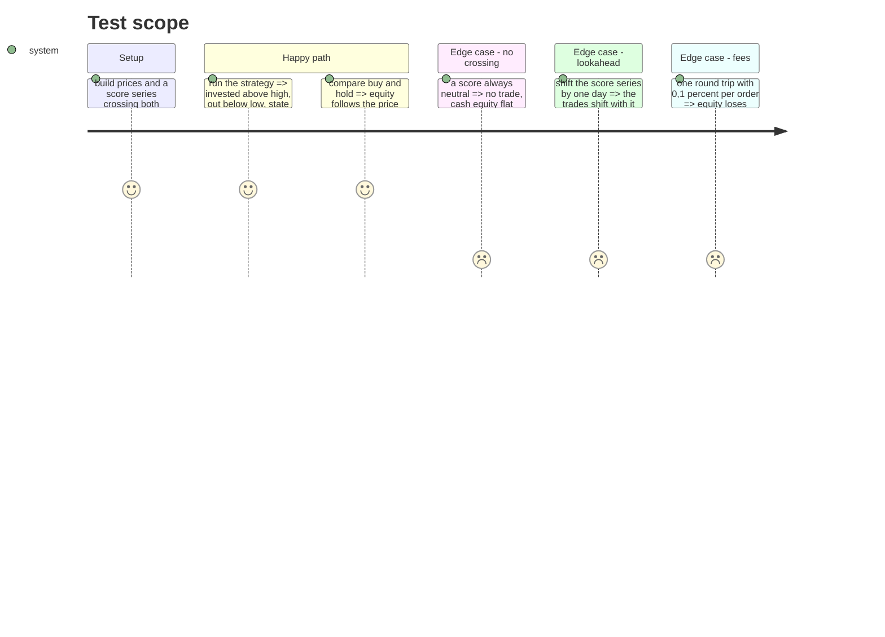

# Instruction: moteur du backtest

## Architecture projection

> Tree of the final files. ✅ create · ✏️ modify · ❌ delete

```txt
.
├── src/obole/engine/momentum_backtest.py   ✅ moteur pur (hystérésis, frais, mesures)
└── tests/test_momentum_backtest.py         ✅ tests unitaires déterministes
```

## User Journey



## Test Scope



## Tasks to do

### `1)` Positions et équité

> Deux courbes, une seule règle.

1. Créer `engine/momentum_backtest.py` avec `backtest(prices, scores, low, high, fee_pct, risk_free_pct)`.
2. Aligner les deux séries sur l'index des prix ; les scores manquants valent « hors marché ».
3. État initial hors marché. Pour `t` de 1 à `n-1` : le score de `t-1` décide — au-dessus de `high` investi, sous `low` dehors, sinon on garde l'état.
4. Appliquer `fee_pct` à chaque changement d'état, puis le rendement `P[t]/P[t-1] − 1` si investi.
5. Buy & hold : entrée à `t0` (même frais), puis `P[t]/P[t0]`.

### `2)` Mesures

> Réutiliser le portefeuille, ne pas réécrire Sharpe.

1. CAGR géométrique sur la durée calendaire ; volatilité annualisée des rendements quotidiens.
2. `portfolio.sharpe_ratio`, `portfolio.sortino_ratio`, `portfolio.drawdown_metrics` sur la courbe d'équité.
3. Calmar = CAGR / |max drawdown| ; temps investi en % ; nombre de trades (entrées).
4. Renvoyer `{buy_hold: {...}, strategy: {...}, window: {...}}`, `None` pour les mesures non calculables.

### `3)` Tester

1. Hystérésis : un score qui monte à 0,8 puis redescend à 0,5 garde la position ; sous 0,3, il sort.
2. Pas de fuite : décaler la série de scores d'un jour décale les trades d'un jour.
3. Frais : un aller-retour à 0,1 % par ordre coûte ~0,2 % sur l'équité.
4. Buy & hold : équité = cours normalisé (aux frais près).
5. Cas plats : score toujours neutre → aucun trade, équité en cash ; série plate → Sharpe `None`.

## Test acceptance criteria

| Task | Acceptance criteria                                                                 |
| ---- | ----------------------------------------------------------------------------------- |
| 1    | Au-dessus de 0,60 la stratégie est investie ; sous 0,35 elle est en cash.            |
| 1    | Entre les deux bornes, l'état précédent est conservé (aucun trade).                  |
| 2    | Les huit mesures sont présentes pour les deux colonnes.                              |
| 3    | Décaler les scores d'un jour décale les trades, jamais l'inverse.                    |
| 3    | Un aller-retour coûte environ 0,2 % et un score toujours neutre ne trade pas.        |
