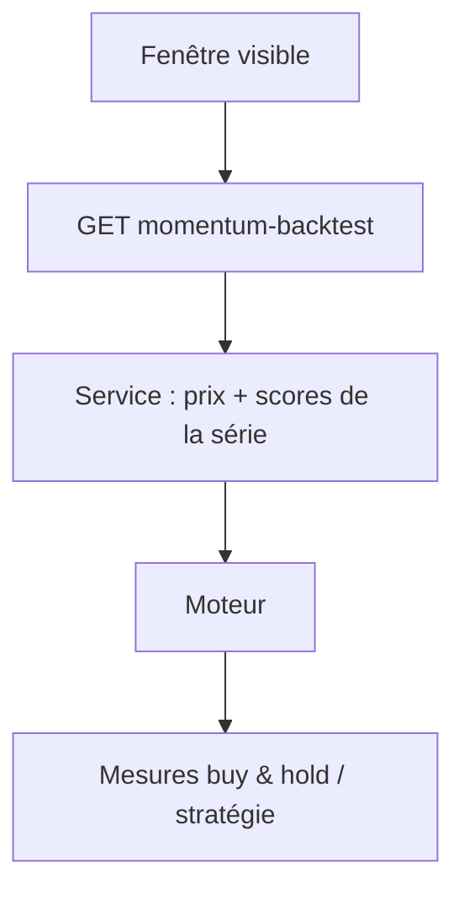
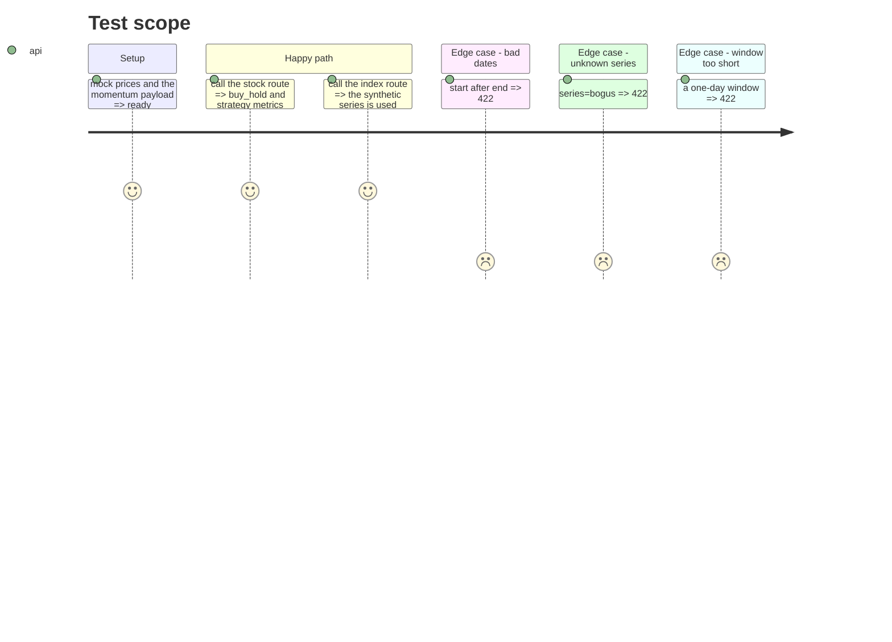

# Instruction: service et routes du backtest

## Architecture projection

> Tree of the final files. ✅ create · ✏️ modify · ❌ delete

```txt
.
├── src/obole/services/momentum.py        ✏️ momentum_backtest(kind, ref, start, end, series)
├── src/obole/api/app.py                  ✏️ deux routes validées
├── src/obole/web/api.js                  ✏️ appel front
└── tests/test_momentum_backtest_api.py   ✅ service et routes
```

## User Journey



## Test Scope



## Tasks to do

### `1)` Service

> Résoudre la référence, trancher la fenêtre, appeler le moteur.

1. Ajouter `momentum_backtest(kind, ref, start, end, series)` dans `services/momentum.py`.
2. `kind == "stock"` : `yahoo.fetch_prices(ref)` ; `kind == "basket"` : `analyze_index(ref)` (série déjà total-return).
3. Choisir `raw` ou `adjusted` (indice : la même série), calculer `satisfaction_series` en pleine résolution.
4. Trancher `[start, end]` ; lever `ValueError` si moins de deux séances.
5. Renvoyer le résultat du moteur avec `window` (dates, nombre de séances).
6. Mesurer le coût à froid (série de satisfaction + backtest) ; au-delà de 100 ms, cacher la série pleine dans `cache` (kind `momentum_series`).

### `2)` Routes

> Deux routes, une validation, pas de logique.

1. `GET /api/stock/{ticker}/momentum-backtest?start=&end=&series=` et `GET /api/index/{id}/momentum-backtest?start=&end=&series=`.
2. Valider les dates ISO (`date.fromisoformat`), `start < end`, `series in {raw, adj}` → 422.
3. Traduire `TickerNotFound` / `IndexNotFound` en 404, `ValueError` en 422.

### `3)` Appel front

1. Ajouter `api.momentumBacktest(kind, ref, start, end, series)` dans `api.js`, via `_loadOrThrow`.

### `4)` Tester

1. Route action : 200, `buy_hold` et `strategy` présents avec les huit mesures.
2. Route indice : 200, la série synthétique est utilisée (pas d'appel ticker).
3. Dates inversées, `series=bogus`, fenêtre d'un jour : 422.
4. Ticker inconnu : 404.

## Test acceptance criteria

| Task | Acceptance criteria                                                                 |
| ---- | ----------------------------------------------------------------------------------- |
| 1    | Le service renvoie les deux jeux de mesures et la fenêtre tranchée.                  |
| 2    | Les trois cas invalides répondent 422 ; un ticker inconnu répond 404.                |
| 3    | `api.momentumBacktest` construit l'URL avec les quatre paramètres encodés.           |
| 4    | Les tests API couvrent action, indice et les quatre erreurs.                         |
