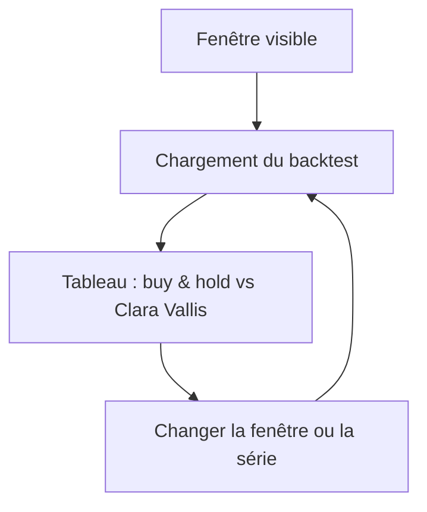
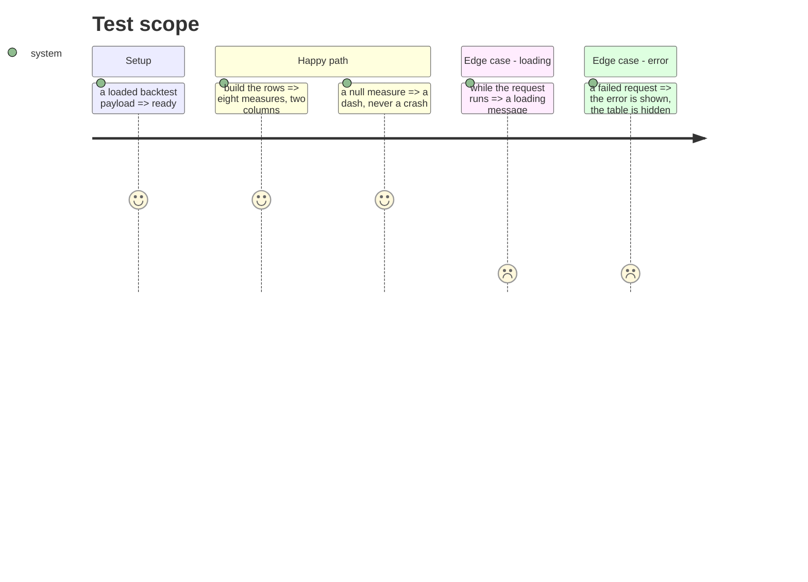

# Instruction: table de fiabilité et chargement

## Architecture projection

> Tree of the final files. ✅ create · ✏️ modify · ❌ delete

```txt
.
├── src/obole/web/momentum.js     ✏️ état, chargement, lignes du tableau
├── src/obole/web/index.html      ✏️ carte « Fiabilité de l'indicateur »
├── src/obole/web/style.css       ✏️ styles du tableau et des états
└── web-tests/momentum.test.js    ✏️ lignes, formatage, états vides
```

## User Journey



## Test Scope



## Wireframe

```txt
┌──────────────────────────────────────────────────────────────┐
│ (1) Fiabilité de l'indicateur                                │
│  Sur la série affichée (brute) — 10 ans                      │
│  ┌────────────────────────────────────────────────────────┐  │
│  │ (2) Mesure     │ Buy & hold       │ Clara Vallis        │  │
│  │ CAGR           │ 6,8 %            │ 9,1 %               │  │
│  │ Volatilité     │ 18,2 %           │ 12,4 %              │  │
│  │ Sharpe         │ 0,37             │ 0,73                │  │
│  │ Sortino        │ 0,52             │ 1,04                │  │
│  │ Max drawdown   │ −38,4 %          │ −19,7 %             │  │
│  │ Calmar         │ 0,18             │ 0,46                │  │
│  │ Temps investi  │ 100 %            │ 64 %                │  │
│  │ Trades         │ 1                │ 7                   │  │
│  └────────────────────────────────────────────────────────┘  │
└──────────────────────────────────────────────────────────────┘
```

1. Carte sous l'historique, avec la légende de la série et de la fenêtre.
2. Tableau à trois colonnes : la mesure, le buy & hold, la stratégie.

## Tasks to do

### `1)` État et chargement

> Une requête par fenêtre, pas par pixel.

1. Ajouter `momBacktest`, `momBacktestLoading`, `momBacktestError` au mixin.
2. `loadMomentumBacktest()` : construire `kind` (`stock` / `basket`) et `ref` depuis `identity`, `start`/`end` depuis `momVisible()` (dates ISO), puis appeler `api.momentumBacktest`.
3. Poser un jeton de requête : une réponse ancienne ne remplace pas la récente.
4. Déclencher au premier dessin, au preset, au relâchement de la poignée et au changement de série.

### `2)` Lignes

> Huit mesures, deux colonnes, `—` quand non calculable.

1. `momBacktestRows()` : `CAGR`, `Volatilité`, `Sharpe`, `Sortino`, `Max drawdown`, `Calmar`, `Temps investi`, `Trades`.
2. Formater en % (deux décimales), en ratio (deux décimales), en entier pour les trades.
3. `—` pour `null`, sans jamais afficher `Infinity` ni `NaN`.

### `3)` Carte et états

1. Ajouter la carte sous l'historique, avec la légende « sur la série affichée (brute/ajustée) » et la durée.
2. État de chargement discret, erreur lisible, tableau masqué tant qu'il n'y a pas de données.

### `4)` Tester

1. `momBacktestRows()` sur un payload connu : huit lignes, deux valeurs par ligne.
2. Une mesure `null` donne `—`.
3. L'état d'erreur est posé quand l'appel échoue (mock de `api.momentumBacktest`).

## Test acceptance criteria

| Task | Acceptance criteria                                                                 |
| ---- | ----------------------------------------------------------------------------------- |
| 1    | Une réponse tardive ne remplace pas une réponse plus récente.                        |
| 2    | Huit lignes, deux colonnes, `—` pour les mesures absentes.                           |
| 3    | La carte annonce la série et la durée de la fenêtre.                                 |
| 4    | Le chargement et l'erreur sont visibles ; le tableau reste masqué sans données.      |
