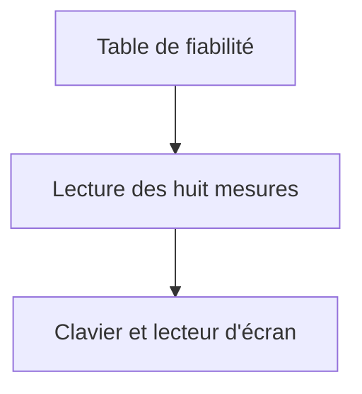
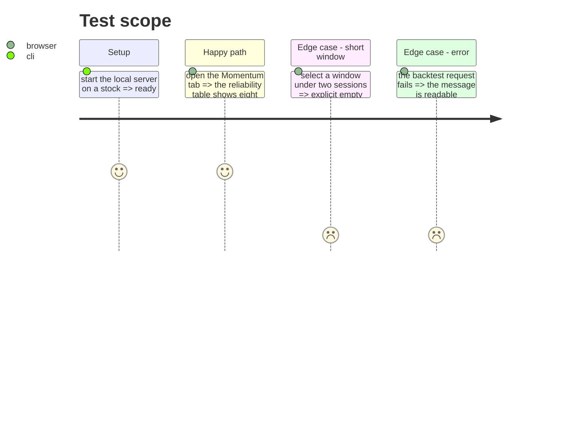

# Instruction: finitions, preuve et documentation

## Architecture projection

> Tree of the final files. ✅ create · ✏️ modify · ❌ delete

```txt
.
├── src/obole/web/momentum.js        ✏️ états vides et accessibilité
├── src/obole/web/index.html         ✏️ messages, attributs ARIA
├── src/obole/web/style.css          ✏️ responsive, focus, mouvement réduit
├── web-tests/e2e/momentum.spec.js   ✏️ smoke du backtest
├── PRD.md                           ✏️ §5.12 Fiabilité
├── chantiers/31-clara-vallis-fiabilite.md ✏️ statut et note de reprise
├── CHANTIERS.md                     ✏️ statut de l'index
├── aidd_docs/memory/architecture.md ✏️ module momentum_backtest
└── aidd_docs/memory/design.md       ✏️ conventions de la table
```

## User Journey



## Test Scope



## Tasks to do

### `1)` Dégradations

1. Fenêtre de moins de deux séances : « Fenêtre trop courte pour mesurer ».
2. Aucun trade : la colonne stratégie affiche 0 trade et une équité plate, pas une erreur.
3. Aucune baisse : Sortino `—`, avec une infobulle qui l'explique.
4. Échec réseau : message lisible, tableau masqué, pas de bloc vide.

### `2)` Accessibilité

1. `<caption>` sur le tableau, `scope="col"` sur les en-têtes.
2. L'état de chargement porte `aria-live="polite"`.
3. `:focus-visible` sur les chips et la poignée (déjà global, à vérifier).
4. Les nombres restent alignés à droite et lisibles à 200 % de zoom.

### `3)` Responsive

1. Le tableau défile horizontalement sous 640 px, sans casser la carte.
2. La légende passe sur deux lignes sans pousser le tableau.

### `4)` Preuve

1. Étendre `web-tests/e2e/momentum.spec.js` : huit lignes, deux colonnes, changement de fenêtre qui met à jour au moins une valeur.
2. Vérifier l'absence d'erreur console sur la fiche.

### `5)` Documentation

1. `PRD.md` §5.12 : la règle d'hystérésis, le décalage d'un jour, les frais, les mesures et leur source.
2. `aidd_docs/memory/architecture.md` : le module `momentum_backtest`, la réutilisation des mesures du portefeuille, le calcul sur la série pleine.
3. `aidd_docs/memory/design.md` : la table à trois colonnes et sa légende.
4. `chantiers/31-clara-vallis-fiabilite.md` : statut et note de reprise ; `CHANTIERS.md` : ligne à jour.

## Test acceptance criteria

| Task | Acceptance criteria                                                                 |
| ---- | ----------------------------------------------------------------------------------- |
| 1    | Une fenêtre courte ou un échec affiche un message, jamais un tableau vide.           |
| 2    | Le tableau a un `caption` et des en-têtes `scope="col"`.                             |
| 3    | À 640 px, le tableau défile sans déborder de la carte.                               |
| 4    | Le smoke e2e passe sur Chromium et WebKit.                                           |
| 5    | `pytest -m "not network"`, `npm test` et `npm run test:e2e` verts.                  |
