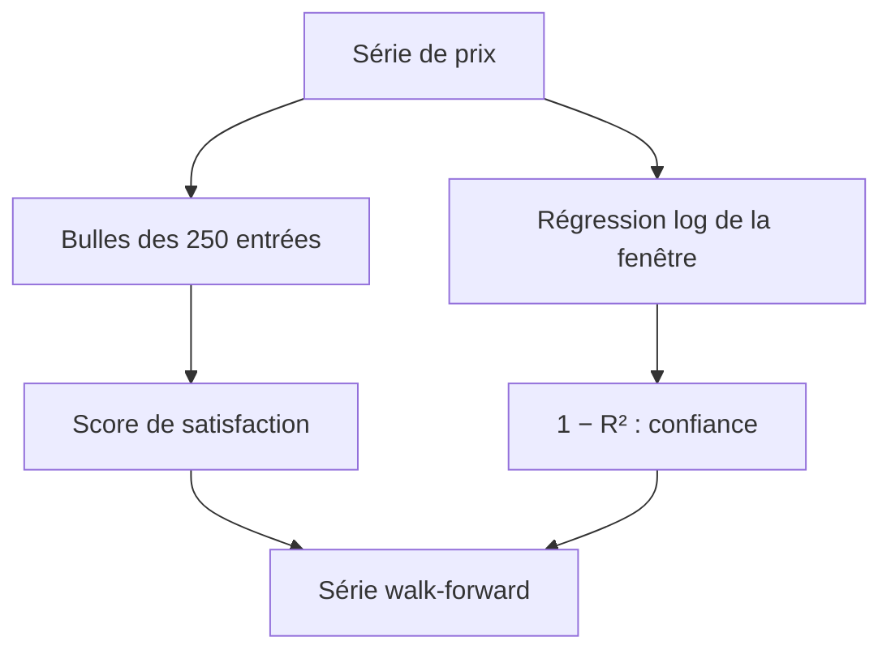
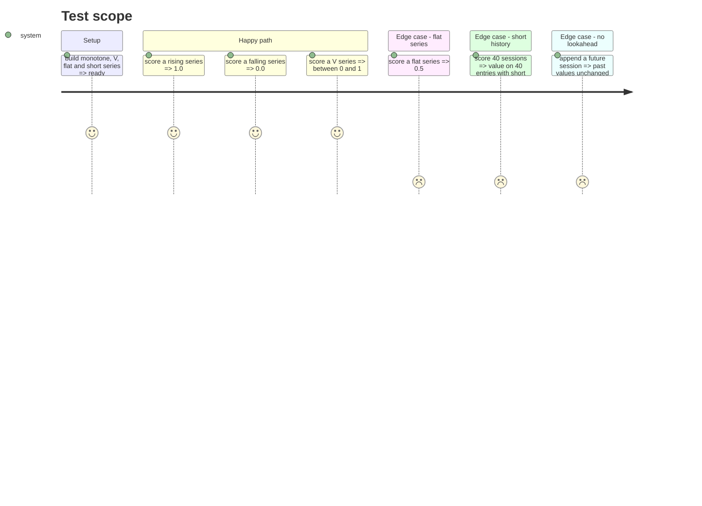

# Instruction: moteur de la Clara Vallis

## Architecture projection

> Tree of the final files. ✅ create · ✏️ modify · ❌ delete

```txt
.
├── src/obole/models.py                  ✏️ SatisfactionResult
├── src/obole/engine/clara_vallis.py     ✅ moteur pur (bulle, série, régime)
└── tests/test_clara_vallis.py           ✅ tests unitaires déterministes
```

## User Journey



## Test Scope



## Tasks to do

### `1)` Bulle et score

> La position de la bulle pour une entrée, puis la moyenne des 250 entrées.

1. Créer `engine/clara_vallis.py` avec `WINDOW = 250`.
2. `bubble_position(prices) -> float` : `(p[-1] - min) / (max - min)`, `0.5` si `max == min`.
3. `satisfaction_score(prices, window=250) -> SatisfactionResult` : moyenne des bulles des `window` dernières séances ; `short_history=True` si `len < window` ; `value=None` si `len < 2`.
4. Ajouter `SatisfactionResult` (`value: float | None`, `n_used: int`, `short_history: bool`) à `models.py`.

### `2)` Série walk-forward

> Le score à chaque date, sans jamais lire une séance postérieure.

1. `satisfaction_series(prices, window=250) -> pd.Series` : `NaN` avant `window - 1`, puis le score de la fenêtre `[t-window+1, t]`.
2. Vectoriser avec `np.lib.stride_tricks.sliding_window_view(prices, window)`, puis `minimum.accumulate` / `maximum.accumulate` sur chaque ligne inversée : aucune boucle Python par séance.
3. Découper les dates en blocs de 2 000 pour borner la mémoire : une vue `(9 000, 250)` garde environ 110 Mo de pointe, un bloc n'en garde qu'une vingtaine.
4. À la date `t`, la dernière entrée de la foule est `t` elle-même : la fenêtre est fermée à droite, jamais décalée.

### `3)` Confiance de la droite

> `1 − R²` de `ln(prix)` sur le temps.

1. `regime_score(prices) -> float | None` : OLS de `ln(p)` sur les années, `R² = 1 − SS_res / SS_tot`.
2. `None` si moins de 2 points ou si `SS_tot == 0` ; résultat borné dans `[0, 1]`.
3. `1.0` = marché chaotique, `0.0` = droite parfaite.

### `4)` Tester le moteur

1. Monotone croissant → `1.0` ; décroissant → `0.0` ; plat → `0.5`.
2. V (80 → 200 → 120) → score strictement entre 0 et 1.
3. Série de 40 points → `short_history`, `n_used == 40`.
4. Série de 300 points, puis on ajoute une séance : les 50 dernières valeurs de `satisfaction_series` sont identiques.
5. `regime_score` : droite parfaite → `0.0` ; bruit fort → supérieur à `0.5`.
6. Créer `spikes/spike_clara_vallis_perf.py` : imprime les temps pour 2 500 / 5 000 / 10 000 séances (mesurés au 2026-10-29 : 6,1 / 10,6 / 17,8 ms).
7. Ajouter un garde-fou de temps dans les tests : 10 000 séances en moins d'une seconde — il attrape une réintroduction de boucle Python, pas une variation de machine.

## Test acceptance criteria

| Task | Acceptance criteria                                                                   |
| ---- | ------------------------------------------------------------------------------------- |
| 1    | Une série strictement croissante donne 1,0 et une série strictement décroissante 0,0. |
| 1    | Une série plate donne 0,5 ; une série de 40 points renvoie `short_history`.           |
| 2    | `satisfaction_series` renvoie `NaN` sur les 249 premières séances.                     |
| 2    | Ajouter une séance future ne modifie aucune valeur passée de la série.                 |
| 3    | Une série parfaitement log-linéaire donne une confiance de 0,0.                       |
| 4    | 10 000 séances se calculent en moins d'une seconde (garde-fou anti-boucle).           |
