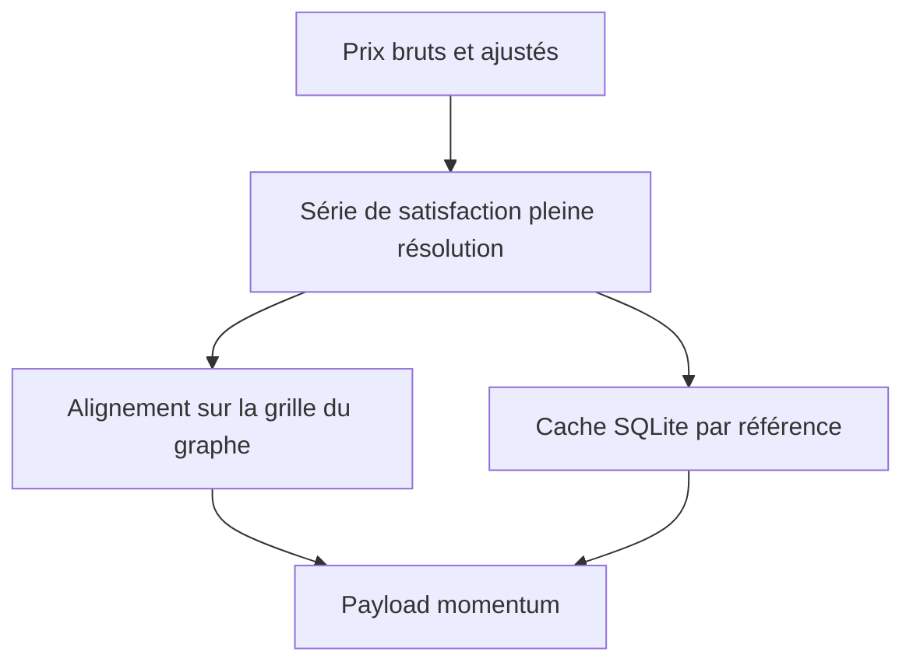
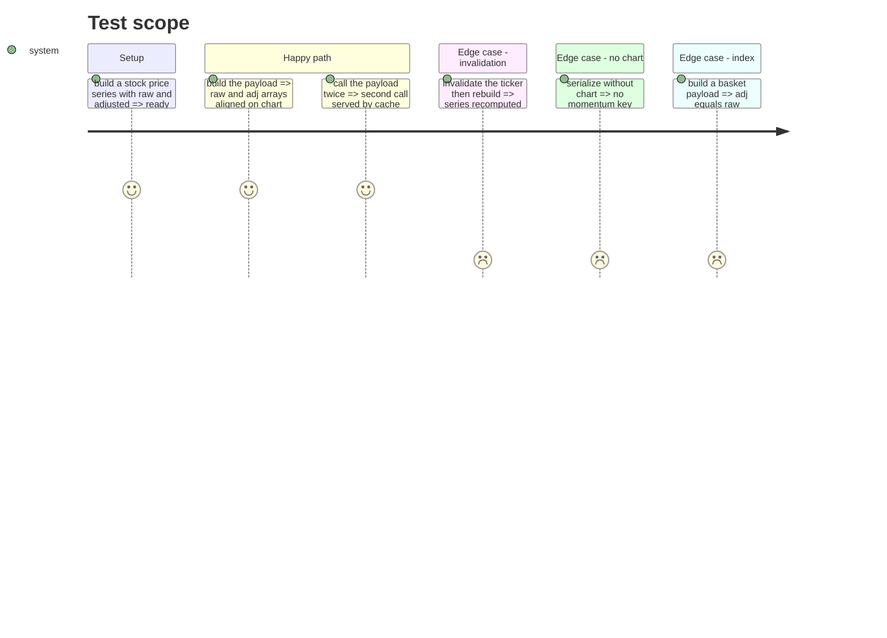

# Instruction: payload et cache du momentum

## Architecture projection

> Tree of the final files. ✅ create · ✏️ modify · ❌ delete

```txt
.
├── src/obole/services/momentum.py      ✅ calcul, alignement, cache
├── src/obole/services/serialize.py     ✏️ branchement action + indice
├── src/obole/config.py                 ✏️ TTL et fenêtre du moteur
└── tests/test_momentum_service.py      ✅ payload, cache, invalidation
```

## User Journey



## Test Scope



## Tasks to do

### `1)` Calcul et cache

> Une fonction unique, appelée par la sérialisation, qui renvoie le bloc `momentum`.

1. Créer `services/momentum.py` avec `momentum_payload(ref, raw, adjusted)`.
2. Calculer `satisfaction_series` en pleine résolution pour `raw`, puis pour `adjusted` si fourni.
3. Lire d'abord `cache.get(ref, "momentum", config.TTL_PRICES)` ; ne recalculer qu'en cas de miss, puis `cache.put`.
4. Laisser `cache.invalidate(ref)` purger l'entrée : aucun code d'invalidation spécifique.

### `2)` Alignement et tranche d'un an

> Les tableaux suivent exactement la grille `chart.dates` ; la vue à un an garde le pas quotidien.

1. Réindexer les séries sur `_downsample(raw).index` — la même grille que `chart_payload`.
2. Arrondir à 4 décimales et convertir les `NaN` en `None`.
3. Construire `year` avec les 250 dernières séances pleine résolution : `dates`, `raw`, `adj`.
4. Exposer `score_raw`, `score_adj`, `n_used`, `short_history`, `raw`, `adj`, `year`.

### `3)` Branchement dans la sérialisation

> Action et indice, jamais ratio, jamais MCP.

1. Dans `analysis_to_dict`, après `chart_payload`, ajouter `out["chart"]["momentum"] = momentum_payload(ident.ticker, prices.raw, prices.adjusted)`.
2. Dans `basket_to_dict`, ajouter `momentum_payload(f"INDEX:{analysis.index_id}", series, None)`.
3. Ne rien ajouter à `ratio_to_dict` : un ratio n'a pas d'onglet Momentum.
4. Vérifier que `include_chart=False` n'ajoute aucune clé `momentum`.

### `4)` Tester le service

1. Payload d'une action : `len(raw) == len(chart.dates)` et `len(year.dates) <= 250`.
2. Deuxième appel : le calcul n'est pas refait (compter les appels à `satisfaction_series`).
3. `cache.invalidate(ticker)` puis appel : le calcul est refait.
4. Indice : `adj is None` et `year.adj is None`.
5. `analysis_to_dict(..., include_chart=False)` : pas de clé `chart`.
6. Mesurer à froid (les deux séries) sur 10 000 séances : sous 500 ms — garde-fou large, le calcul mesuré tourne autour de 20 ms par série.

## Test acceptance criteria

| Task | Acceptance criteria                                                                  |
| ---- | ------------------------------------------------------------------------------------ |
| 1    | Le payload expose `raw`, `adj`, `score_raw`, `n_used` et `year`.                      |
| 2    | Les tableaux `raw` et `adj` ont exactement la longueur de `chart.dates`.              |
| 2    | `year.dates` se termine sur la dernière séance et contient au plus 250 entrées.       |
| 3    | Le payload d'un indice a `adj` à `None` ; celui d'un ratio n'a pas de `momentum`.     |
| 4    | Le second appel est servi par le cache ; après invalidation, il recalcule.            |
| 4    | Le payload à froid sur 10 000 séances reste sous 500 ms.                              |
