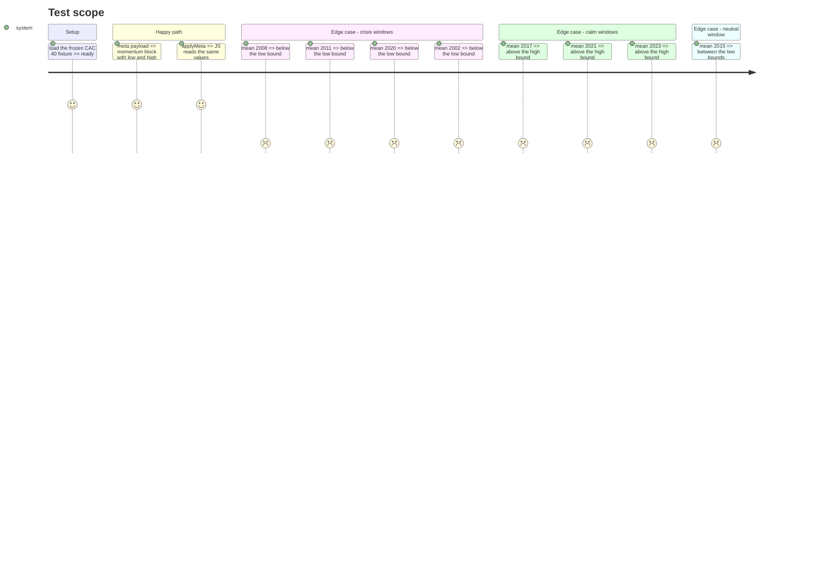

# Instruction: seuils et calibration hors ligne

## Architecture projection

> Tree of the final files. ✅ create · ✏️ modify · ❌ delete

```txt
.
├── src/obole/config.py                      ✏️ MOMENTUM_* et hauteurs
├── src/obole/api/app.py                     ✏️ bloc momentum de /api/meta
├── src/obole/web/thresholds.js              ✏️ applyMeta et état MOMENTUM
├── tests/fixtures/generate_cac40_fixture.py ✅ générateur (réseau, à la demande)
├── tests/fixtures/cac40_daily.csv           ✅ série figée 2000 → 2023
├── spikes/spike_clara_vallis.py             ✅ calibration hors ligne
├── tests/test_clara_vallis_calibration.py   ✅ verrou pur, sans réseau
└── web-tests/momentum-parity.test.js        ✅ parité config → JS
```

## User Journey

```mermaid
flowchart TD
  A[Fixture CAC 40 figée] --> B[Série de satisfaction]
  B --> C[Fenêtres de crise et de calme]
  C --> D[Bornes LOW et HIGH]
  D --> E[config.py]
  E --> F[/api/meta]
  F --> G[thresholds.js]
```

## Test Scope



## Tasks to do

### `1)` Constantes serveur

> Les bornes et les hauteurs, à source unique.

1. Dans `config.py`, ajouter `MOMENTUM_WINDOW = 250`, `MOMENTUM_SATISFACTION_LOW = 0.35`, `MOMENTUM_SATISFACTION_HIGH = 0.60`.
2. Ajouter `MOMENTUM_TABLE_WINDOWS = (1, 5, 10, 20, 0)` — `0` signifie « maximum ».
3. Ajouter `CHART_HEIGHT_MOMENTUM_YEAR = 240` et `CHART_HEIGHT_MOMENTUM_HISTORY = 380`.

### `2)` Exposition et lecture

> Le front ne redéfinit aucun seuil.

1. Dans `GET /api/meta`, ajouter `"momentum": {"window", "low", "high", "table_windows"}`.
2. Dans `thresholds.js`, exporter `MOMENTUM = { window: 0, low: 0, high: 0, table_windows: [] }` et le remplir dans `applyMeta`.
3. Ne mettre aucune valeur par défaut qui masquerait un oubli : `metaReady` reste la garde.

### `3)` Fixture et calibration

> Une série figée une fois pour toutes, puis les bornes mesurées hors ligne.

1. Créer `tests/fixtures/generate_cac40_fixture.py` : télécharge `^FCHI` du 2000-01-01 au 2023-12-31, écrit `cac40_daily.csv` (`date,close`, en-tête avec la source et la date de génération).
2. Générer la fixture une fois et la commiter : 6 134 lignes, 114 Ko — la fin au 2023-12-31 la rend reproductible.
3. Créer `spikes/spike_clara_vallis.py` : lit le CSV (aucun réseau), calcule `satisfaction_series`, imprime la moyenne par fenêtre.
4. Consigner les mesures du 2026-10-29 : crises 0,174 (2008-09 → 2009-03) · 0,239 (2011-07 → 2011-10) · 0,255 (2020-02 → 2020-04) · 0,174 (2002-06 → 2002-10) ; calmes 0,762 (2017) · 0,859 (2021) · 0,704 (2023) ; 0,515 (2015-06 → 2015-09) dans la bande neutre.
5. Retenir `LOW = 0.35` et `HIGH = 0.60` : marge minimale de 0,095 côté crise, 0,104 côté calme.

### `4)` Verrouiller

1. Créer `tests/test_clara_vallis_calibration.py`, **pur** (aucun marqueur `network`), qui lit la fixture et recalcule la série.
2. Assertions : les quatre fenêtres de crise `< LOW`, les trois fenêtres de calme `> HIGH`, la fenêtre 2015 strictement entre les deux.
3. Vérifier que le test ne dépend ni de la date du jour ni du réseau.
4. Créer `web-tests/momentum-parity.test.js` : lit `config.py`, construit le payload et vérifie que `applyMeta` remplit `MOMENTUM` à l'identique.

## Test acceptance criteria

| Task | Acceptance criteria                                                                  |
| ---- | ------------------------------------------------------------------------------------ |
| 1    | `config.MOMENTUM_SATISFACTION_LOW` est strictement inférieur à `HIGH`.                |
| 2    | `/api/meta` expose les quatre champs et le front les lit après `applyMeta`.           |
| 3    | La fixture fait au moins 6 000 lignes et se termine sur la dernière séance de 2023.                    |
| 4    | Le test de calibration passe dans `pytest -m "not network"`, sans réseau.             |
| 4    | Quatre crises sous la borne basse, trois calmes au-dessus de la haute, 2015 entre.    |
