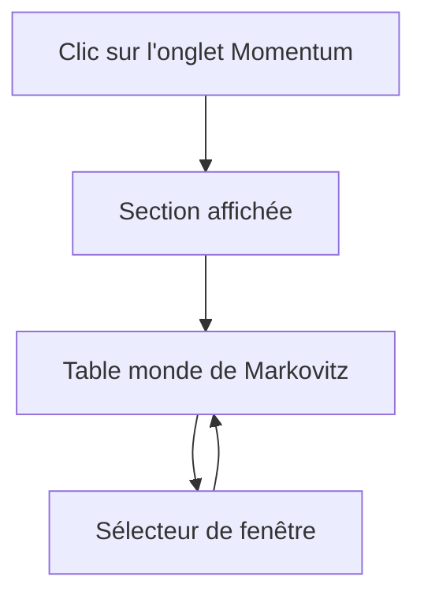
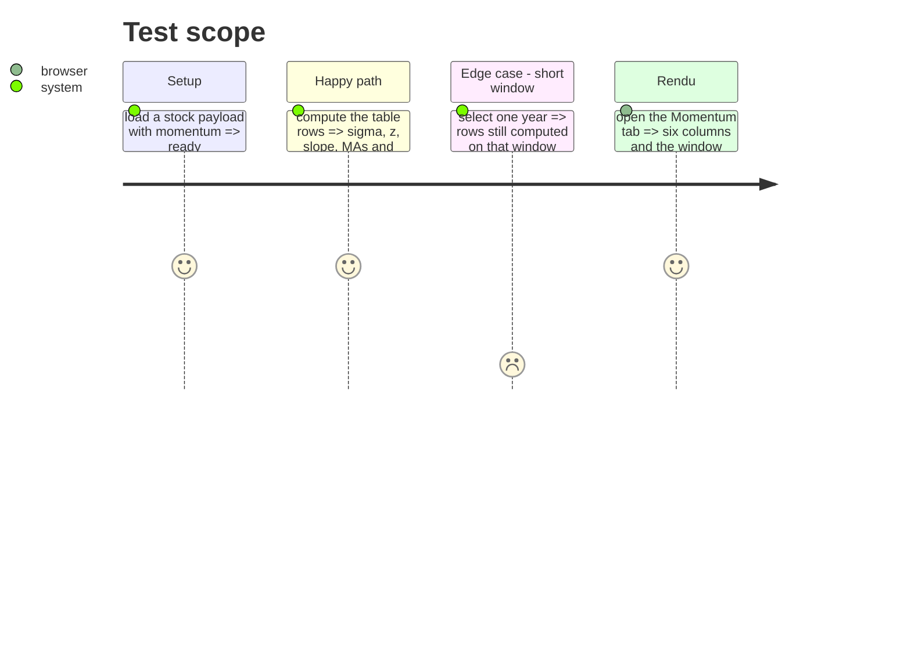

# Instruction: onglet Momentum et table

## Architecture projection

> Tree of the final files. ✅ create · ✏️ modify · ❌ delete

```txt
.
├── src/obole/web/sections.js       ✏️ SECTIONS et expectedMiniIds
├── src/obole/web/charts.js         ✏️ sectionAvailable et routage du rendu
├── src/obole/web/momentum.js       ✅ mixin (état, table)
├── src/obole/web/app.js            ✏️ import et fusion du mixin
├── src/obole/web/index.html        ✏️ template de la section
├── src/obole/web/style.css         ✏️ table et carte
└── web-tests/momentum.test.js      ✅ momRows sur payload synthétique
```

## User Journey



## Test Scope



## Wireframe

```txt
┌──────────────────────────────────────────────────────────────┐
│ (1) Onglets : … Valorisation │ Momentum │                    │
├──────────────────────────────────────────────────────────────┤
│ (2) Le monde de Markovitz                                    │
│  ┌────────────────────────────────────────────────────────┐  │
│  │ (3) Fenêtre [1A][5A][10A][20A][MAX]   ● brute ○ ajustée │  │
│  │ (4) σ (bande) │ z │ pente │ MM court │ MM long │ confiance │
│  │     28,4 %    │−1,2│ 6,8 % │  112,4   │ 105,8   │   0,31    │
│  └────────────────────────────────────────────────────────┘  │
└──────────────────────────────────────────────────────────────┘
```

1. Barre d'onglets de la fiche : la nouvelle entrée après Valorisation.
2. Titre du groupe.
3. Sélecteur de fenêtre et bascule de série.
4. Table : les six mesures et la confiance.

## Tasks to do

### `1)` Déclarer l'onglet

> Une entrée de plus dans le registre, à la bonne place.

1. Ajouter `{ id: "momentum", label: "Momentum", svg: … }` après `valorisation` dans `SECTIONS`.
2. Dans `expectedMiniIds`, retourner `[]` pour `momentum` : la phase 4 ne trace aucun graphe.

### `2)` Rendre la section disponible

> Actions et indices seulement, et seulement si le payload porte le bloc.

1. Dans `sectionAvailable`, brancher `momentum` : `kind_payload` vaut `stock` ou `basket`, et `chart.momentum` existe avec `n_used >= 2`.
2. Retourner `false` pour un ratio.

### `3)` Écrire le mixin et la table

> Tous les calculs sont locaux, sur la fenêtre choisie.

1. Créer `momentum.js` avec `momSeries: "raw"`, `momWindow: 5`, `momRows()`.
2. `momSeriesData()` : `this.data.chart.momentum[this.momSeries]`, aligné sur `chart.dates`.
3. `momSlice()` : indices de la fenêtre `momWindow` (0 = maximum) sur `chart.dates`.
4. `momRows()` : `olsLog` sur la tranche, puis σ de la bande (`(e^sigma − 1) × 100`), z (distance à la droite en σ), pente (`(e^b − 1) × 100`), MM court/long (dernières valeurs du payload), confiance (`1 − R²`, calculée par `sigma² × (n−1) / SS_tot`).
5. Fusionner le mixin dans `app.js`.

### `4)` Poser le template et le style

1. Ajouter la section `x-show="activeSection === 'momentum'"` avec le titre et la carte de table.
2. Chips `MOMENTUM.table_windows` et bascule brute/ajustée.
3. Styles de table dans `style.css`, sans toucher aux classes partagées.

### `5)` Tester

1. `web-tests/momentum.test.js` : payload synthétique, vérifier σ, z, pente et confiance sur une droite parfaite et sur une série bruitée.
2. Vérifier que la fenêtre 1A et la fenêtre MAX donnent des valeurs différentes.

## Test acceptance criteria

| Task | Acceptance criteria                                                              |
| ---- | -------------------------------------------------------------------------------- |
| 1    | L'onglet apparaît après Valorisation et ouvre la section au clic.                 |
| 2    | L'onglet est absent sur un ratio et présent sur un indice.                        |
| 3    | Une droite log-parfaite donne une confiance de 0,0 et un z de 0,0.                |
| 3    | Changer de fenêtre change les valeurs affichées.                                  |
| 4    | La table affiche six colonnes et les chips de fenêtre.                            |
