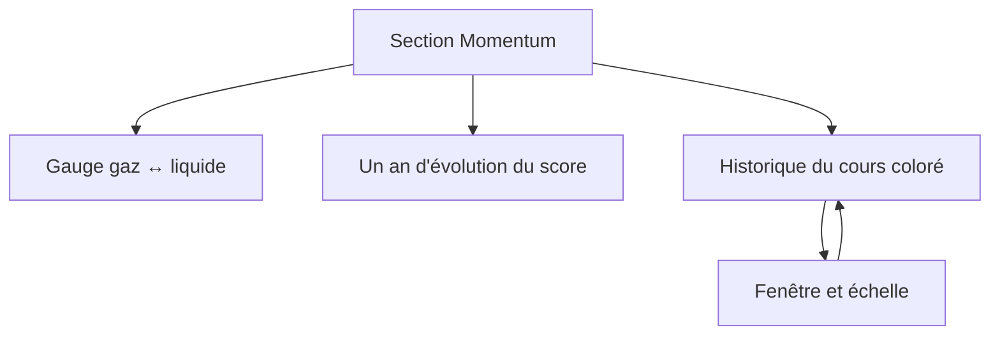
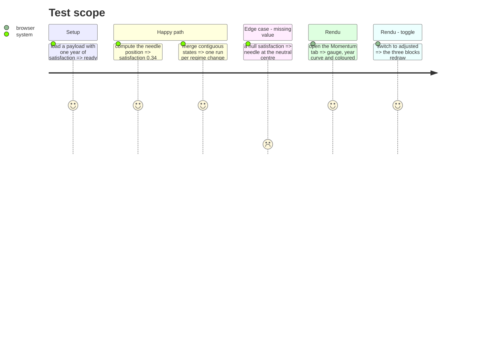

# Instruction: jauge, vue à un an et historique coloré

## Architecture projection

> Tree of the final files. ✅ create · ✏️ modify · ❌ delete

```txt
.
├── src/obole/web/momentum.js     ✏️ jauge, courbe, historique, plage dédiée
├── src/obole/web/index.html      ✏️ les trois cartes
├── src/obole/web/style.css       ✏️ jauge, légende, responsive
└── web-tests/momentum.test.js    ✏️ position de l'aiguille et fusion des états
```

## User Journey



## Test Scope



## Wireframe

```txt
┌──────────────────────────────────────────────────────────────┐
│ (1) Invalidation ? : La Clara Vallis                         │
│  ┌────────────────────────────────────────────────────────┐  │
│  │ (2) Satisfaction de la foule                    0,34   │  │
│  │  gaz ●──────────●─────────○───────────● liquide        │  │
│  │      satisfaite                    frustrée            │  │
│  └────────────────────────────────────────────────────────┘  │
│  ┌────────────────────────────────────────────────────────┐  │
│  │ (3) Un an d'évolution du score                         │  │
│  │  1 ┤─────────── haut ────────────────────────          │  │
│  │    │      ╱╲    ╱╲                                     │  │
│  │  0 ┤────╱──╲──╱──╲────────── bas ─────────────────     │  │
│  └────────────────────────────────────────────────────────┘  │
│  ┌────────────────────────────────────────────────────────┐  │
│  │ (4) Historique du régime [1A][5A][10A][MAX] ☐ log ☐ droite │
│  │  ┌──────────────────────────────────────────────────┐  │  │
│  │  │ ░░░▓▓▓▓░░░░▓▓▓▓▓░░░░░░░░░░░░░░░░░░░░░░░░░░░░░░░  │  │  │
│  │  │ ───────╱╲────╱╲──────────────────────────╱╲─────  │  │  │
│  │  └──────────────────────────────────────────────────┘  │  │
│  │ (5) [═══════●═══════════════════════════════════●════]  │  │
│  └────────────────────────────────────────────────────────┘  │
└──────────────────────────────────────────────────────────────┘
```

1. Titre du groupe, avec le nom de la méthode.
2. Jauge : score courant, aiguille, deux pôles.
3. Courbe du score sur douze mois, avec les bandes de seuils.
4. Historique : cours, fond coloré par état, régression optionnelle.
5. Double poignée de la plage, propre à ce graphe.

## Tasks to do

### `1)` Jauge

> Une aiguille lisible, sans dépendance à Plotly.

1. `momGaugePos()` : `(1 − score) × 100`, borné à `[0, 100]` ; `50` si le score est nul.
2. Markup : piste à deux zones (bleu à gauche, rouge à droite), aiguille, échelle « gaz · satisfaite » / « liquide · frustrée ».
3. `role="meter"`, `aria-valuemin="0"`, `aria-valuemax="1"`, `aria-valuenow` et un libellé texte.

### `2)` Vue à un an

> Le score quotidien, avec ses seuils visibles.

1. `drawMomentumYear()` sur `mom-year` : ligne du score, deux droites horizontales aux bornes, deux zones colorées.
2. Axe Y fixe `[0, 1]`, ticks `0 / 0,5 / 1`, hauteur `CHART_HEIGHTS.momentum_year`.
3. État vide si `year.dates` est vide.

### `3)` Historique coloré

> Le cours, et le régime en fond.

1. `momRuns()` : fusionne les séances contiguës de même état (`bas` / `neutre` / `haut`) en intervalles.
2. `drawMomentumHistory()` sur `mom-history` : cours en ligne, rectangles de fond par intervalle, droite optionnelle en pointillé, échelle log optionnelle.
3. Plage dédiée `momStart`/`momEnd`, initialisée sur les 10 dernières années ; chips `1A/5A/10A/MAX` et double poignée.
4. Ne jamais toucher `rangeStart`/`rangeEnd` du héro.

### `4)` Bascule et redessin

1. `momSeries` bascule `raw`/`adj` et redessine les trois blocs.
2. Dans `redrawActiveSection`, appeler `drawMomentum()` quand `activeSection === "momentum"`.
3. Dans `expectedMiniIds`, retourner `["mom-year", "mom-history"]` pour `momentum`.

### `5)` Tester

1. `momGaugePos()` : 1,0 → 0 ; 0,0 → 100 ; `null` → 50.
2. `momRuns()` : trois séances `bas`, deux `haut`, trois `bas` → trois intervalles.
3. `momRuns()` : une série entièrement `neutre` → un seul intervalle.

## Test acceptance criteria

| Task | Acceptance criteria                                                              |
| ---- | -------------------------------------------------------------------------------- |
| 1    | L'aiguille est à gauche pour une foule satisfaite et à droite pour une foule frustrée. |
| 2    | La courbe à un an affiche les deux seuils et les zones colorées.                 |
| 3    | L'historique affiche le cours et des bandes de fond aux changements de régime.   |
| 3    | Les chips et la double poignée ne déplacent pas le graphe du Résumé.             |
| 4    | Basculer brut/ajusté redessine la jauge, la courbe et l'historique.              |
