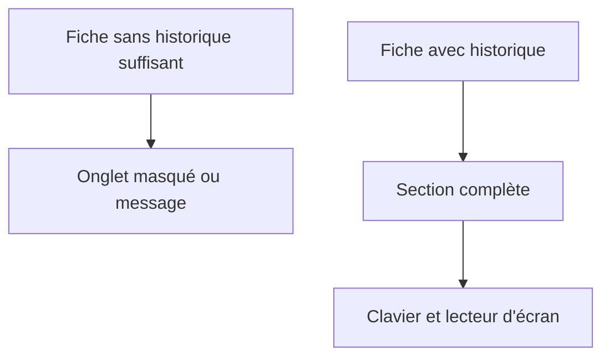
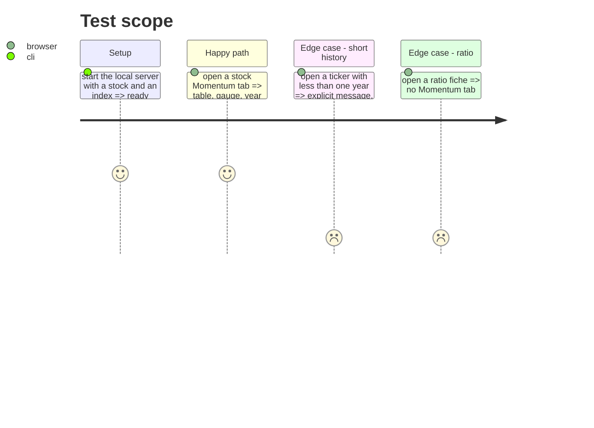

# Instruction: finitions, dégradations et documentation

## Architecture projection

> Tree of the final files. ✅ create · ✏️ modify · ❌ delete

```txt
.
├── src/obole/web/momentum.js         ✏️ états vides et accessibilité
├── src/obole/web/index.html          ✏️ messages et attributs ARIA
├── src/obole/web/style.css           ✏️ focus, responsive, mouvement réduit
├── web-tests/e2e/momentum.spec.js    ✅ smoke Playwright
├── PRD.md                            ✏️ §5.11 La Clara Vallis
├── chantiers/30-clara-vallis.md      ✏️ statut et note de reprise
├── CHANTIERS.md                      ✏️ statut de l'index
├── aidd_docs/memory/design.md        ✏️ conventions de l'onglet
└── aidd_docs/memory/architecture.md  ✏️ module clara_vallis
```

## User Journey



## Test Scope



## Tasks to do

### `1)` Dégradations

> Une absence se dit, elle ne casse rien.

1. Moins de 250 séances : badge « historique court » à côté du score.
2. Moins d'un an : la carte à un an affiche « Pas encore un an d'historique » et l'historique reste tracé sans bandes.
3. Série ajustée absente : bascule désactivée avec une infobulle.
4. Bloc absent : section masquée par `sectionAvailable`, jamais un cadre vide.

### `2)` Accessibilité

1. La jauge porte `role="meter"` et un `aria-label` qui cite le score et l'état.
2. Les chips et la bascule ont un `:focus-visible` et un libellé accessible.
3. Les bandes de couleur sont doublées d'une légende texte.
4. `prefers-reduced-motion` : aucune transition sur l'aiguille.

### `3)` Responsive

1. Sous 900 px, les trois cartes passent en une colonne.
2. La table défile horizontalement sans casser la mise en page.
3. Le graphe historique garde `min-width: 0` dans `.charts-grid`.

### `4)` Preuve de bout en bout

1. Créer `web-tests/e2e/momentum.spec.js` : ouvrir `#RI.PA/momentum`, vérifier la table, la jauge et les deux tracés Plotly.
2. Vérifier qu'un ratio (`CW8.PA/SPY`) n'a pas l'onglet.
3. Vérifier qu'un indice ouvre la section.

### `5)` Documentation

1. `PRD.md` : ajouter §5.11 « La Clara Vallis — régime de foule » avec les formules et les seuils.
2. `aidd_docs/memory/architecture.md` : décrire `engine/clara_vallis.py` et le cache `momentum`.
3. `aidd_docs/memory/design.md` : consigner la jauge et les bandes.
4. `chantiers/30-clara-vallis.md` : statut et note de reprise ; `CHANTIERS.md` : ligne à jour.

## Test acceptance criteria

| Task | Acceptance criteria                                                              |
| ---- | -------------------------------------------------------------------------------- |
| 1    | Un ticker à historique court affiche le badge et ne casse aucun bloc.            |
| 2    | La jauge est annoncée comme un `meter` avec sa valeur.                           |
| 3    | À 900 px, les trois cartes sont empilées et lisibles.                            |
| 4    | Le smoke e2e passe sur Chromium et WebKit.                                       |
| 5    | `pytest -m "not network"`, `npm test` et `npm run test:e2e` sont verts.          |
