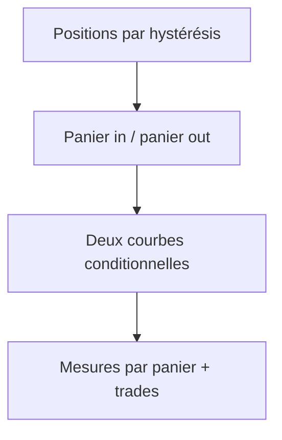
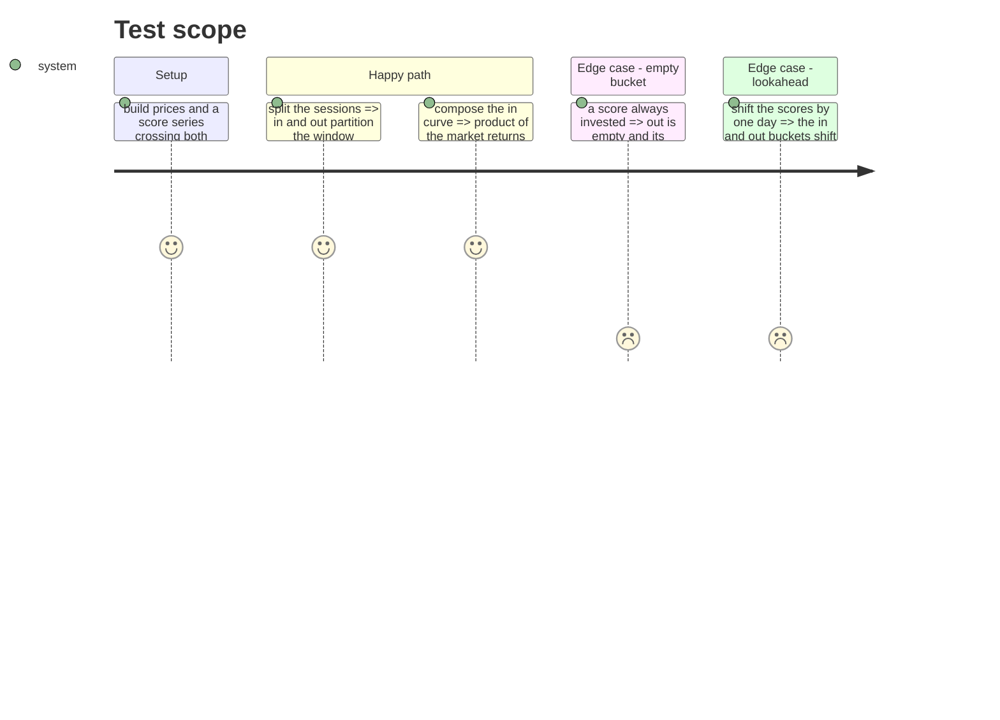

# Instruction: moteur in/out

## Architecture projection

> Tree of the final files. ✅ create · ✏️ modify · ❌ delete

```txt
.
├── src/obole/engine/momentum_backtest.py   ✏️ blocs in/out, trades, courbes conditionnelles
└── tests/test_momentum_backtest.py         ✏️ partition, composition, panier vide
```

## User Journey



## Test Scope



## Tasks to do

### `1)` Classer les séances

> Chaque séance de rendement appartient à in ou à out.

1. Reprendre les positions existantes (`positions[t]` décidée par le score de `t-1`).
2. Calculer les rendements du marché `P[t]/P[t-1] − 1` pour `t` de 1 à `n-1`.
3. Ranger chaque rendement dans le panier de `positions[t]` : in (1) ou out (0).

### `2)` Composer les courbes

> Deux courbes qui ne contiennent que leurs séances.

1. Courbe in = produit cumulé des `(1 + r)` des séances in ; courbe out = idem pour out.
2. Une courbe part de 1 ; un panier vide donne une courbe vide (`None` en sortie).
3. Buy & hold : produit cumulé de tous les rendements (frais d'entrée déjà appliqués).

### `3)` Mesurer

> Les mêmes mesures, sur chaque panier.

1. CAGR annualisé sur les séances du panier : `courbe[-1] ** (252 / n_panier) − 1`.
2. Volatilité annualisée, Sharpe, Sortino et drawdown via `engine/portfolio` sur la courbe.
3. Calmar = CAGR / |max drawdown| ; part des séances = `n_panier / (n-1) × 100`.
4. `trades` = nombre d'entrées de la stratégie, et `strategy_cagr_pct` = son CAGR (cash compris), en sortie de premier niveau.
5. Remplacer le bloc `strategy` complet par `in` et `out` ; garder `equity`/`positions` internes aux tests.

### `4)` Tester

1. Partition : `len(in) + len(out) == n - 1` et les deux parts somment à 100 %.
2. Composition : la courbe in égale le produit des rendements des seules séances in.
3. Panier vide : `out` à `None` (mesures nulles, part 0 %), pas de crash.
4. Pas de fuite : décaler les scores d'un jour décale les paniers.
5. Frais : inchangés sur le buy & hold.

## Test acceptance criteria

| Task | Acceptance criteria                                                                 |
| ---- | ----------------------------------------------------------------------------------- |
| 1    | In et out partitionnent les séances de rendement, sans trou ni doublon.               |
| 2    | La courbe in ne contient que les rendements des séances in.                          |
| 3    | Le CAGR d'un panier est annualisé sur ses propres séances.                           |
| 3    | `trades` et `strategy_cagr_pct` sortent une fois, en premier niveau.                  |
| 4    | Un panier vide donne des mesures nulles et une part de 0 %, sans crash.              |
