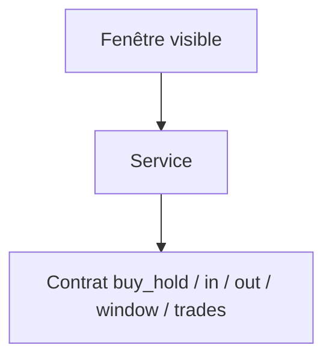
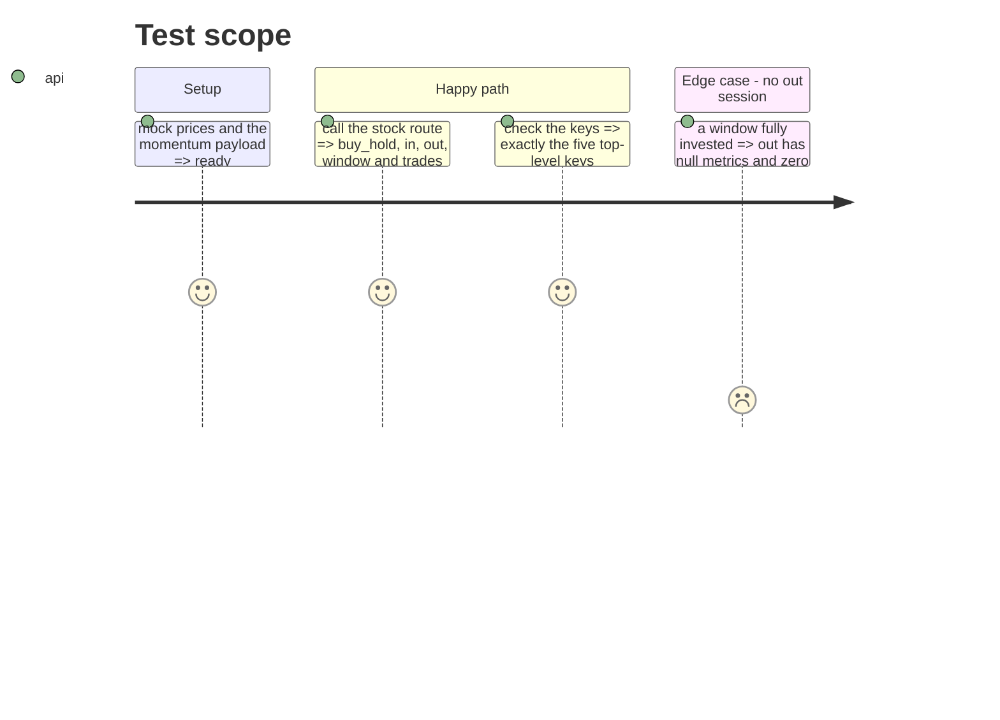

# Instruction: service et route in/out

## Architecture projection

> Tree of the final files. ✅ create · ✏️ modify · ❌ delete

```txt
.
├── src/obole/services/momentum.py        ✏️ _MEASURES, _public_result
├── src/obole/api/app.py                  ✏️ docstring du contrat
└── tests/test_momentum_backtest_api.py   ✏️ clés exactes et trades
```

## User Journey



## Test Scope



## Tasks to do

### `1)` Contrat

> Le transport expose les deux paniers, plus la stratégie.

1. Dans `services/momentum.py`, `_public_result` renvoie `{buy_hold, in, out, window, trades, strategy_cagr_pct}`.
2. `_MEASURES` reste la liste des sept mesures (CAGR, volatilité, Sharpe, Sortino, max drawdown, Calmar, part des séances).
3. Ne jamais exposer `equity`, `positions` ni l'ancien bloc `strategy`.

### `2)` Route

1. Mettre à jour la docstring de la route : le contrat décrit in/out et `trades`.
2. Ne pas changer les paramètres (`start`, `end`, `series`) ni les codes d'erreur.

### `3)` Tester

1. `set(data) == {"buy_hold", "in", "out", "window", "trades", "strategy_cagr_pct"}`.
2. `set(data["in"]) == set(_MEASURES)` et idem pour `out` et `buy_hold`.
3. Une fenêtre entièrement investie : `out` à mesures nulles, part 0 %.
4. Aucune trace de `strategy`, `equity`, `positions` dans la réponse.

## Test acceptance criteria

| Task | Acceptance criteria                                                                 |
| ---- | ----------------------------------------------------------------------------------- |
| 1    | La réponse porte exactement six clés de premier niveau.                              |
| 1    | Les trois colonnes portent les sept mêmes mesures.                                   |
| 2    | Les paramètres et les erreurs de la route sont inchangés.                            |
| 3    | Un panier vide renvoie des mesures nulles, jamais une erreur.                        |
