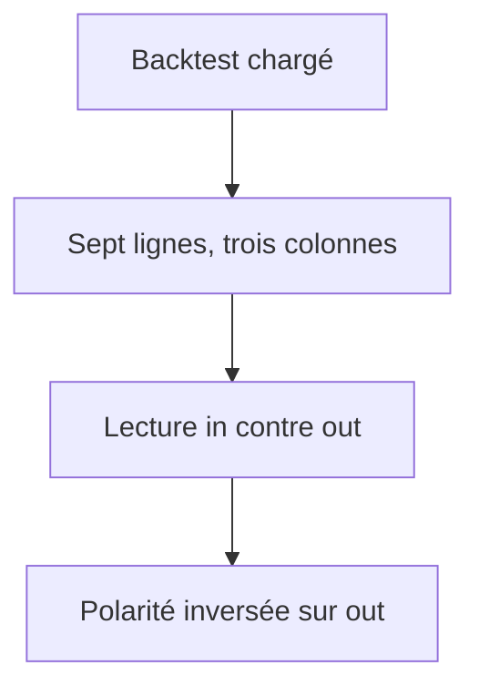
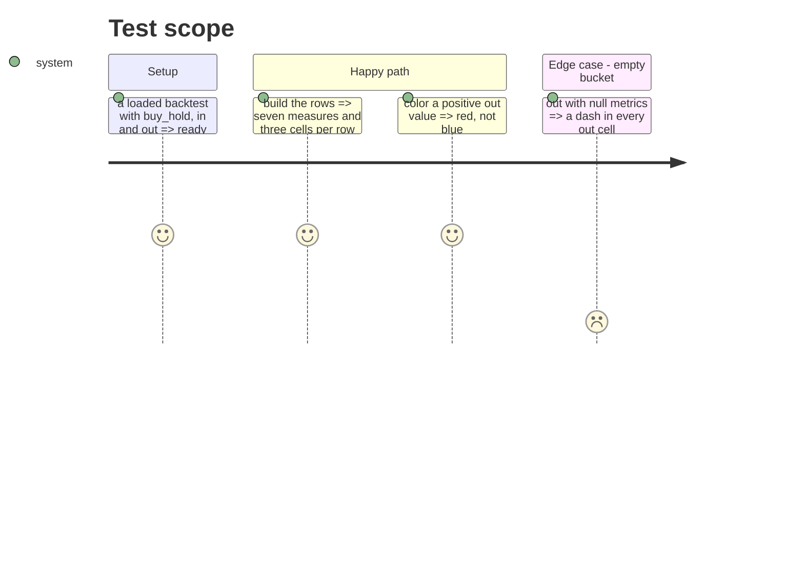

# Instruction: table à trois colonnes

## Architecture projection

> Tree of the final files. ✅ create · ✏️ modify · ❌ delete

```txt
.
├── src/obole/web/momentum.js     ✏️ lignes in/out, polarité inversée, trades
├── src/obole/web/index.html      ✏️ en-têtes, pied, légende
├── src/obole/web/style.css       ✏️ quatre colonnes
└── web-tests/momentum.test.js    ✏️ polarité, panier vide, trades
```

## User Journey



## Test Scope



## Wireframe

```txt
┌──────────────────────────────────────────────────────────────┐
│ (1) Fiabilité de l'indicateur                                │
│  Marché sur la fenêtre — 10 ans, série ajustée               │
│  ┌────────────────────────────────────────────────────────┐  │
│  │ (2) Mesure     │ Buy & hold │ in         │ out          │  │
│  │ CAGR           │ 6,8 %      │ 9,1 %      │ −2,4 %       │  │
│  │ Volatilité     │ 18,2 %     │ 21,4 %     │ 12,1 %       │  │
│  │ Sharpe         │ 0,37       │ 0,58       │ −0,11        │  │
│  │ Sortino        │ 0,52       │ 0,81       │ −0,16        │  │
│  │ Max drawdown   │ −38,4 %    │ −44,2 %    │ −9,7 %       │  │
│  │ Calmar         │ 0,18       │ 0,21       │ −0,25        │  │
│  │ Part des séances │ 100 %    │ 64 %       │ 36 %         │  │
│  └────────────────────────────────────────────────────────┘  │
│ (3) 27 trades · stratégie 4,2 %/an · drawdown conditionnel   │
└──────────────────────────────────────────────────────────────┘
```

1. Carte sous l'historique, avec la série et la durée.
2. Tableau : la mesure, buy & hold, in, out.
3. Pied : le nombre de trades et la légende de lecture.

## Tasks to do

### `1)` Lignes et polarité

1. `momBacktestRows()` : sept lignes, chacune avec `label` et trois cellules `{value, good}`.
2. Mesures signées (CAGR, Sharpe, Sortino, Calmar) : `good` = valeur positive pour buy & hold et in, **négative pour out**.
3. Volatilité, max drawdown et part des séances : neutres (`good: null`).
4. `momBacktestTrades()` : le nombre de trades, `—` s'il manque.

### `2)` Table et pied

1. En-têtes : `Mesure`, `Buy & hold`, `in`, `out`.
2. Une cellule `—` quand la mesure est nulle.
3. Pied de table : `N trades · stratégie X %/an`, puis la légende « le marché pendant les séances in et out ; la stratégie n'est investie qu'une partie du temps. Le drawdown des paniers est conditionnel. ».

### `3)` Styles

1. Quatre colonnes, nombres alignés à droite, en-têtes `scope="col"`.
2. Le tableau défile horizontalement sous 640 px, sans déborder de la carte.

### `4)` Tester

1. Sept lignes, trois cellules par ligne.
2. Un `out` positif est `good: false` ; un `in` positif est `good: true`.
3. Un panier vide donne `—` dans ses trois cellules.
4. Le pied affiche le nombre de trades et le CAGR de la stratégie.

## Test acceptance criteria

| Task | Acceptance criteria                                                                 |
| ---- | ----------------------------------------------------------------------------------- |
| 1    | Sept lignes, trois cellules, libellés français.                                      |
| 1    | Un CAGR positif en out est coloré rouge ; le même en in est bleu.                    |
| 2    | Le pied affiche les trades, le CAGR de la stratégie et la légende (drawdown conditionnel). |
| 3    | À 640 px, le tableau défile sans déborder de la carte.                               |
