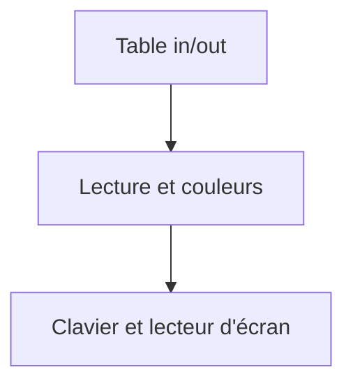
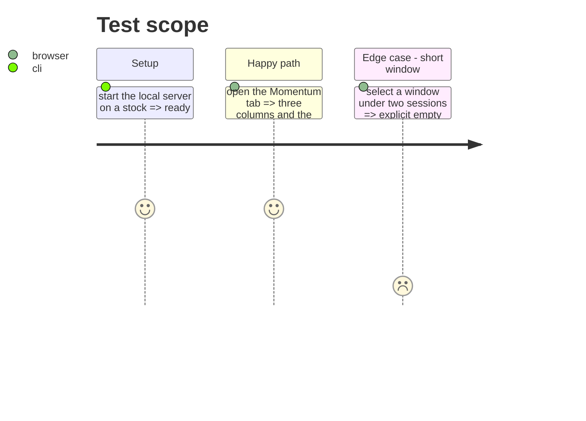

# Instruction: finitions et documentation

## Architecture projection

> Tree of the final files. ✅ create · ✏️ modify · ❌ delete

```txt
.
├── web-tests/e2e/momentum.spec.js        ✏️ smoke in/out
├── PRD.md                                ✏️ §5.12, lecture in/out
├── aidd_docs/memory/design.md            ✏️ colonnes in/out et polarité
├── aidd_docs/memory/architecture.md      ✏️ contrat in/out
├── chantiers/32-momentum-in-out.md       ✏️ statut et note de reprise
└── CHANTIERS.md                          ✏️ statut de l'index
```

## User Journey



## Test Scope



## Tasks to do

### `1)` Preuve de bout en bout

1. Étendre `web-tests/e2e/momentum.spec.js` : trois colonnes (`Buy & hold`, `in`, `out`), sept lignes, pied avec le nombre de trades.
2. Vérifier qu'une valeur positive en `out` porte la classe `bad` (polarité inversée), et la même en `in` la classe `good`.
3. Vérifier l'absence d'erreur console.

### `2)` Accessibilité

1. En-têtes `scope="col"` et `caption` à jour (« marché pendant les séances in et out »).
2. Le pied de table est lisible sans couleur seule : le libellé « N trades » porte l'information.

### `3)` Documentation

1. `PRD.md` §5.12 : remplacer la comparaison stratégie/buy & hold par la lecture in/out, expliquer le CAGR annualisé sur les séances du panier et la polarité inversée.
2. `aidd_docs/memory/design.md` : les trois colonnes et la convention de couleur de `out`.
3. `aidd_docs/memory/architecture.md` : le contrat `{buy_hold, in, out, window, trades}`.
4. `chantiers/32-momentum-in-out.md` : statut et note de reprise ; `CHANTIERS.md` : ligne à jour.

## Test acceptance criteria

| Task | Acceptance criteria                                                                 |
| ---- | ----------------------------------------------------------------------------------- |
| 1    | Le smoke e2e voit trois colonnes et le pied des trades, sur Chromium et WebKit.      |
| 1    | Un `out` positif est rouge, un `in` positif est bleu (classes vérifiées).            |
| 2    | Le `caption` et les `scope` sont présents ; l'information ne dépend pas de la couleur. |
| 3    | Le PRD ne parle plus de la comparaison stratégie/buy & hold.                         |
