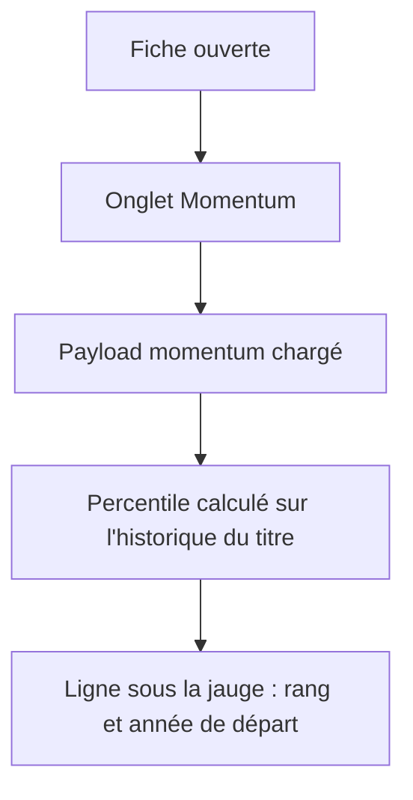
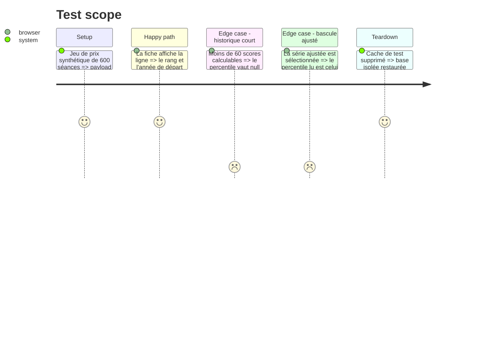

# Instruction: Percentile historique du score

## Architecture projection

> Tree of the final files. ✅ create · ✏️ modify · ❌ delete

```txt
.
├── src/obole/
│   ├── config.py                                   ✏️  MOMENTUM_PERCENTILE_MIN_POINTS
│   ├── engine/
│   │   └── momentum_stats.py                       ✅  score_percentile (pur)
│   ├── services/
│   │   └── momentum.py                             ✏️  percentile_raw/adj + history_start
│   └── web/
│       ├── momentum.js                             ✏️  momPercentile / momPercentileLabel
│       ├── index.html                              ✏️  ligne sous la jauge
│       └── style.css                               ✏️  .mom-percentile
├── tests/
│   ├── test_momentum_stats.py                      ✅  percentile : bornes, série plate, NaN
│   └── test_momentum_service.py                    ✏️  clés du payload, brut/ajusté, indice
└── web-tests/
    └── momentum.test.js                            ✏️  accesseur, libellé, absence
```

## User Journey



## Test Scope



## Wireframe

```txt
┌──────────────────────────────────────────────────────────┐
│ (1) Carte jauge                                          │
│   ┌────────────────────────────────────────────────────┐ │
│   │ Satisfaction de la foule            0,62           │ │
│   │ [=============|=========]                          │ │
│   │ satisfaite                    frustrée             │ │
│   │ (2) rang du score dans l'historique du titre       │ │
│   └────────────────────────────────────────────────────┘ │
└──────────────────────────────────────────────────────────┘
```

1. Carte jauge existante, inchangée par ailleurs.
2. Nouvelle ligne : rang du score dans l'historique du titre et année de départ.

## Tasks to do

### `1)` Moteur : `score_percentile`

> Donner le rang d'une valeur dans une série de scores, en pourcentage entier.

1. Créer `src/obole/engine/momentum_stats.py`, module pur (numpy/pandas seulement).
2. `score_percentile(scores, value, min_points)` : retire les NaN, rend `None` sous `min_points` ou si `value` est absent.
3. Rang = part des scores inférieurs ou égaux à `value`, arrondie en entier 0–100.

### `2)` Service : le percentile dans le payload

> Exposer le rang et la date de départ avec le reste du bloc momentum.

1. Ajouter `MOMENTUM_PERCENTILE_MIN_POINTS = 60` dans `config.py`, à côté du bloc Clara Vallis.
2. Dans `momentum_payload`, calculer `percentile_raw` et `percentile_adj` (ce dernier seulement si la série ajustée existe), sur l'historique complet du titre et non sur la plage affichée.
3. Ajouter `history_start` : première date où le score brut est calculable, au format ISO.
4. Ajouter un suffixe `:lecture` à la clé de cache, pour ne pas servir un payload sans les nouveaux champs.

### `3)` Front : accesseur et libellé

> Lire le percentile de la série affichée et le formater en français.

1. `momPercentile()` : `percentile_adj` quand la bascule est sur ajusté, sinon `percentile_raw` ; `null` si absent ou non fini.
2. `momPercentileLabel()` : ordinal (« 1er », « 51e ») et année de `history_start` ; chaîne vide si le rang manque.

### `4)` UI : la ligne sous la jauge

> Afficher le rang sous l'échelle de la jauge, sans déplacer le reste de la carte.

1. Dans `index.html`, sous `.gauge-scale`, une ligne conditionnée à la présence du rang.
2. Dans `style.css`, `.mom-percentile` : petite taille, texte discret, chiffres tabulaires.

### `5)` Tests

> Couvrir le calcul, le transport et la lecture.

1. `tests/test_momentum_stats.py` : série connue (rang exact), série plate, série trop courte, valeur absente.
2. `tests/test_momentum_service.py` : clés présentes, brut contre ajusté, indice sans série ajustée, date de départ.
3. `web-tests/momentum.test.js` : bascule brut/ajusté, libellé ordinal, absence de rang.

## Test acceptance criteria

| Task | Acceptance criteria |
| ---- | ------------------- |
| 1 | Un score égal au maximum de l'historique rend 100 ; un score inférieur au minimum rend 0 ; sous 60 points rend `None`. |
| 2 | Le payload d'une action porte `percentile_raw`, `percentile_adj` et `history_start` ; celui d'un indice porte `percentile_adj` à `None`. |
| 3 | Changer la bascule brut/ajusté change le rang affiché quand les deux séries diffèrent. |
| 4 | La ligne apparaît sous la jauge quand le rang existe, et disparaît quand il manque. |
| 5 | Les trois suites passent sans réseau. |
