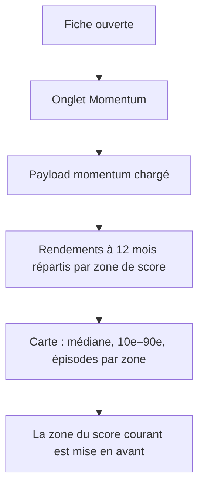
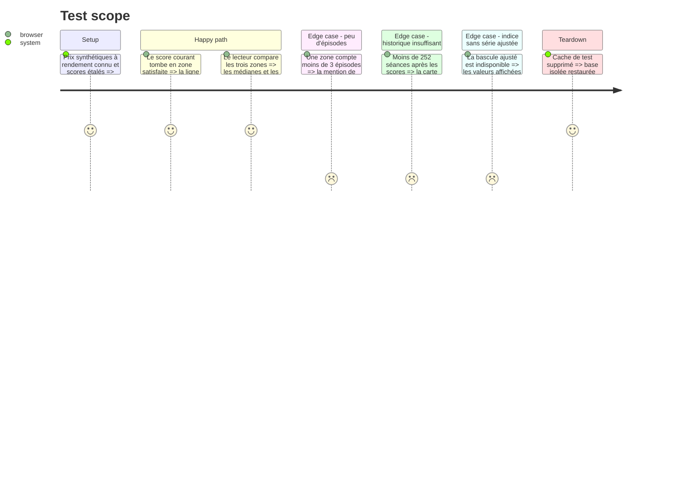

# Instruction: Rendement conditionnel par zone de score

## Architecture projection

> Tree of the final files. ✅ create · ✏️ modify · ❌ delete

```txt
.
├── src/obole/
│   ├── config.py                                   ✏️  MOMENTUM_FORWARD_SESSIONS, MOMENTUM_CONDITIONAL_MIN_EPISODES
│   ├── engine/
│   │   └── momentum_stats.py                       ✏️  conditional_forward_returns (pur)
│   ├── services/
│   │   └── momentum.py                             ✏️  conditional_raw/adj + thin
│   └── web/
│       ├── momentum.js                             ✏️  momConditionalRows / momConditionalNote
│       ├── index.html                              ✏️  carte « ce qui a suivi »
│       └── style.css                               ✏️  .mom-cond-*
├── tests/
│   ├── test_momentum_stats.py                      ✏️  zones, médiane, dispersion, épisodes
│   └── test_momentum_service.py                    ✏️  clés du payload, brut/ajusté, indice
└── web-tests/
    ├── momentum.test.js                            ✏️  lignes, zone courante, absence
    └── e2e/momentum.spec.js                        ✏️  carte visible avec chiffres
```

## User Journey



## Test Scope



## Wireframe

```txt
┌──────────────────────────────────────────────────────────┐
│ (1) Carte jauge  (avec la ligne de percentile, phase 1)  │
├──────────────────────────────────────────────────────────┤
│ (2) Carte rendement conditionnel                         │
│   ┌────────────────────────────────────────────────────┐ │
│   │ (3) tableau : une ligne par zone + repère          │ │
│   │     zone | médiane | 10e–90e | épisodes            │ │
│   │     la zone courante est marquée                   │ │
│   │ (4) note de lecture (chevauchement des fenêtres)   │ │
│   └────────────────────────────────────────────────────┘ │
├──────────────────────────────────────────────────────────┤
│ (5) Carte « un an d'évolution du score »                 │
└──────────────────────────────────────────────────────────┘
```

1. Carte jauge existante, avec la ligne ajoutée en phase 1.
2. Nouvelle carte, placée entre la jauge et le graphe d'un an.
3. Tableau à quatre lignes : zone basse, neutre, haute, et repère global.
4. Note qui dit ce que compte la colonne « épisodes ».
5. Graphe existant, inchangé.

## Tasks to do

### `1)` Moteur : `conditional_forward_returns`

> Répartir les rendements à 12 mois par zone de score, avec un repère global.

1. Ajouter `MOMENTUM_FORWARD_SESSIONS = 252` dans `config.py`.
2. Dans `momentum_stats.py`, `conditional_forward_returns(prices, scores, low, high, horizon)` : aligne les deux séries, calcule `P[t+h]/P[t] − 1`, affecte chaque séance à sa zone.
3. Par zone et pour le repère : médiane, 10e et 90e centiles, et nombre d'épisodes indépendants (démarrages espacés d'au moins `horizon` séances).
4. Rendre `None` par zone quand aucune fenêtre complète n'existe.

### `2)` Service : le conditionnel dans le payload

> Exposer les quatre lignes pour la série brute et la série ajustée.

1. Calculer `conditional_raw` et `conditional_adj` (ce dernier seulement si la série ajustée existe), sur l'historique complet du titre et non sur la plage affichée.
2. Garder la forme : un objet `zones` (bas, neutre, haut), un objet `baseline`, un champ `horizon`.
3. Marquer d'un booléen `thin` chaque bloc dont les épisodes tombent sous `MOMENTUM_CONDITIONAL_MIN_EPISODES` : la prudence est une décision serveur, le front n'affiche qu'un fait.
4. Ne rien recalculer à chaque requête : le bloc vit dans le payload déjà mis en cache.

### `3)` Front : lignes et note

> Construire les quatre lignes et désigner la zone courante.

1. `momConditionalRows()` : quatre lignes (bas, neutre, haut, repère), la zone courante marquée d'après `momState(momScore())`.
2. Formater les pourcentages à une décimale, l'intervalle en « 10e / 90e », les épisodes en entier.
3. `momConditionalNote()` : dire l'horizon de 12 mois, que les fenêtres se chevauchent et que les épisodes sont les fenêtres indépendantes.
4. Masquer la carte quand aucune zone n'a de fenêtre complète.

### `4)` UI : la carte

> Ajouter la carte entre la jauge et le graphe d'un an.

1. Dans `index.html`, une carte avec un tableau à quatre lignes et la note.
2. Dans `style.css`, `.mom-cond-*` : tableau compact, ligne courante distinguée, chiffres tabulaires.

### `5)` Tests

> Couvrir le calcul, le transport et l'affichage.

1. `tests/test_momentum_stats.py` : série à rendement connu, bornes des zones, fenêtres incomplètes, comptage des épisodes.
2. `tests/test_momentum_service.py` : clés présentes, brut contre ajusté, indice sans série ajustée.
3. `web-tests/momentum.test.js` : quatre lignes, zone courante, formatage, absence de données.
4. `web-tests/e2e/momentum.spec.js` : la carte est visible et porte des chiffres.

## Test acceptance criteria

| Task | Acceptance criteria |
| ---- | ------------------- |
| 1 | Une série à rendement constant place la même médiane dans les trois zones ; une série où seuls les scores hauts précèdent une hausse donne une médiane haute supérieure. |
| 2 | Le payload d'une action porte `conditional_raw` et `conditional_adj` ; celui d'un indice porte `conditional_adj` à `None`. |
| 3 | La ligne de la zone courante est distinguée ; changer de score courant change la ligne distinguée. |
| 4 | La carte apparaît entre la jauge et le graphe, et disparaît quand aucune fenêtre complète n'existe. |
| 5 | Les suites backend, front et e2e passent sans réseau. |
